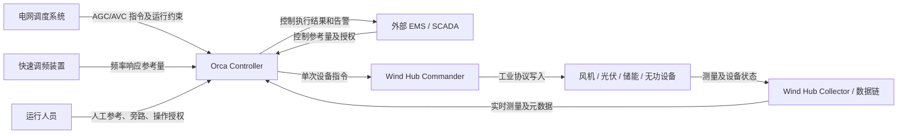
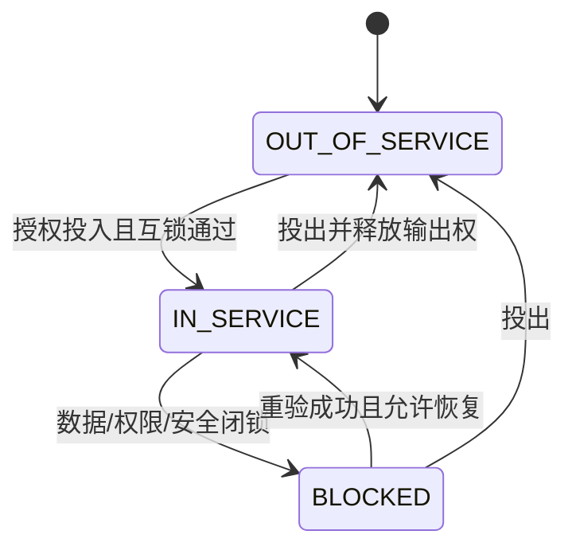
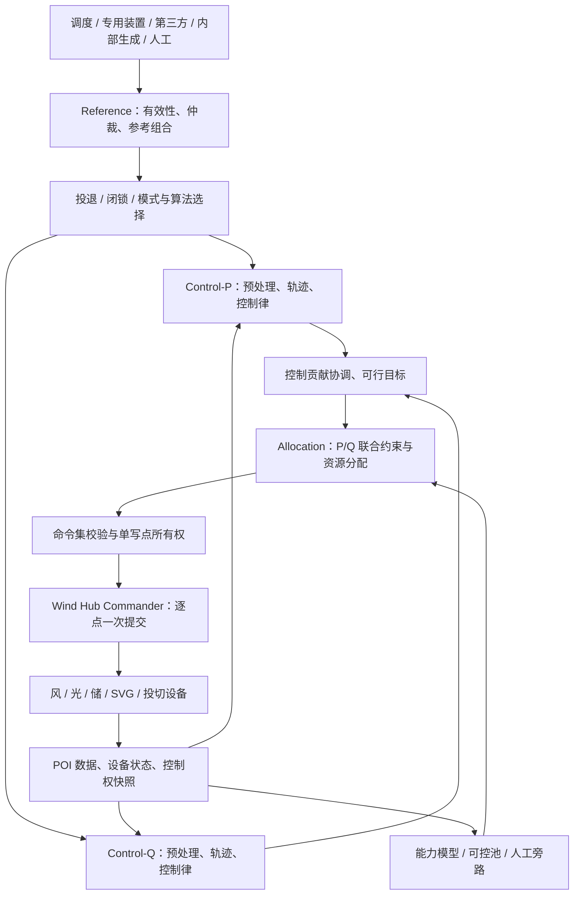
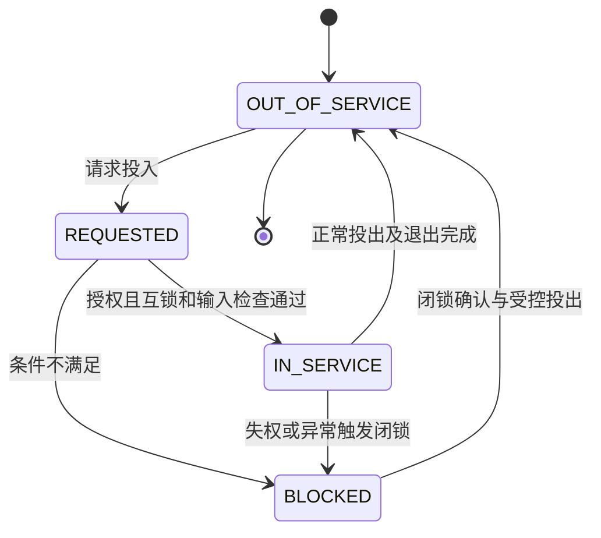
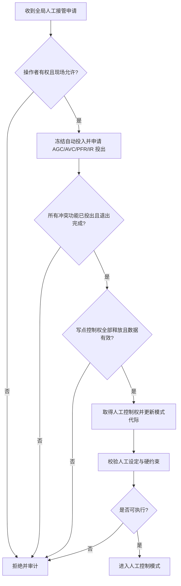
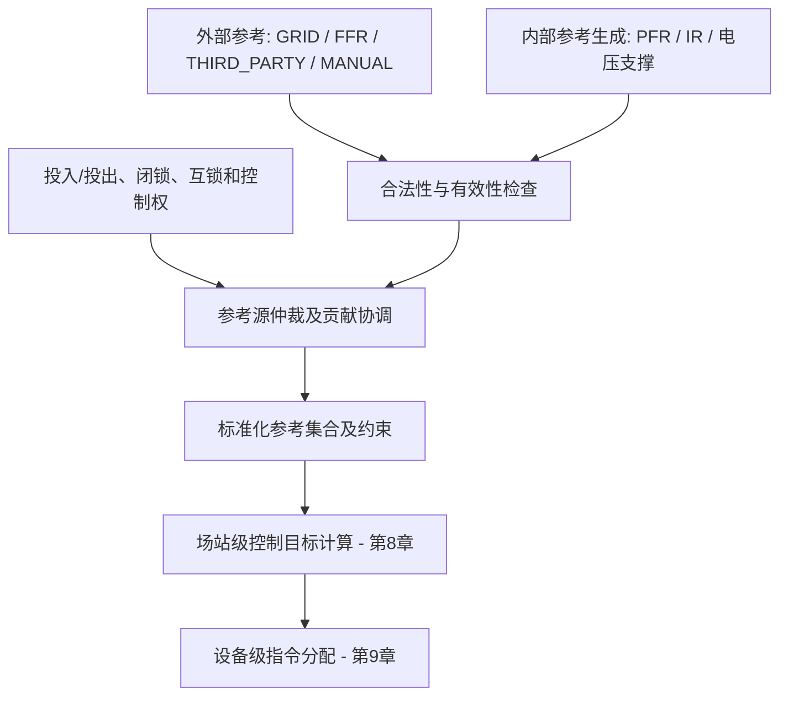
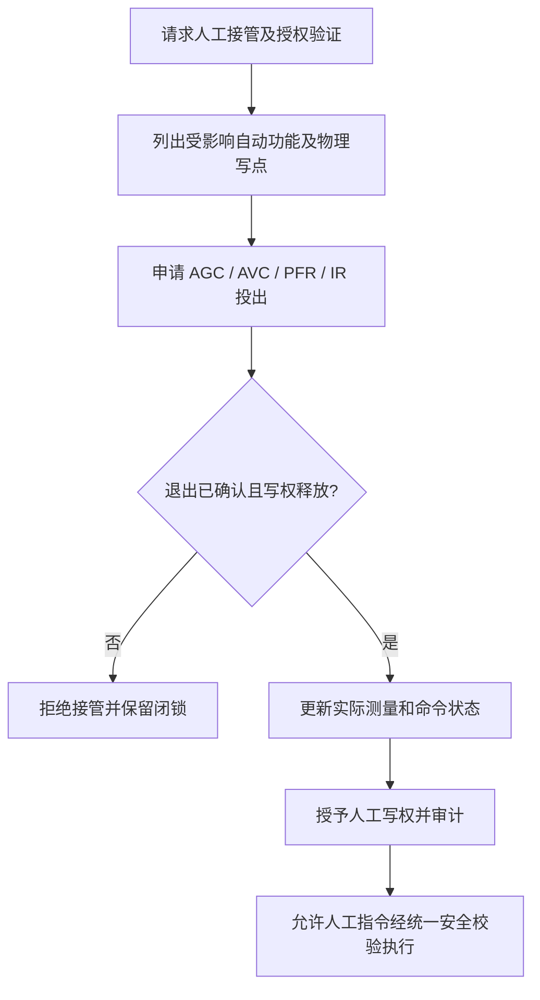
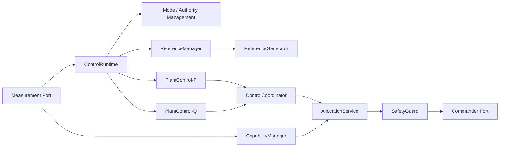
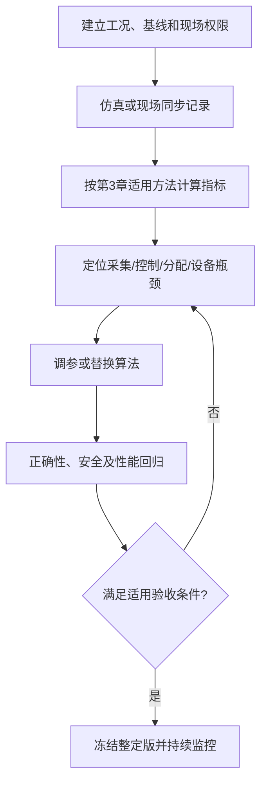

<h1 class="title">Orca Controller 总体技术设计</h1>

<p class="subtitle">v0_11 · 20261013</p>

<style>
body {
  font-family: "Microsoft YaHei";
  font-size: 16px;
  line-height: 1.75;
  color: #24292f;
}
.title {
  font-family: "Microsoft YaHei";
  font-size: 32px;
  line-height: 1.30;
  font-weight: 700;
  text-align: center;
}
.subtitle {
  font-family: "Microsoft YaHei";
  font-size: 18px;
  line-height: 1.50;
  font-weight: 400;
  text-align: center;
}
h1 {
  font-family: "Microsoft YaHei";
  font-size: 28px;
  line-height: 1.40;
  font-weight: 700;
}
h2 {
  font-family: "Microsoft YaHei";
  font-size: 22px;
  line-height: 1.40;
  font-weight: 700;
}
h3 {
  font-family: "Microsoft YaHei";
  font-size: 18px;
  line-height: 1.50;
  font-weight: 700;
}
h4 {
  font-family: "Microsoft YaHei";
  font-size: 16px;
  line-height: 1.50;
  font-weight: 700;
}
p, li {
  font-family: "Microsoft YaHei";
  font-size: 16px;
  line-height: 1.75;
}
.figure-caption,
.formula-caption {
  font-family: "Microsoft YaHei";
  font-size: 14px;
  line-height: 1.50;
  font-weight: 600;
  text-align: center;
  margin: 0.65em 0 0.35em 0;
}
.table-caption {
  font-family: "Microsoft YaHei";
  font-size: 13px;
  line-height: 1.40;
  font-weight: 500;
  text-align: center;
  margin: 0.65em 0 0.35em 0;
}
.mermaid,
.mermaid text,
.mermaid .label {
  font-family: "Microsoft YaHei" !important;
  font-size: 14px !important;
  line-height: 1.20;
}
table {
  width: 100%;
  border-collapse: collapse;
  font-family: "Microsoft YaHei";
  font-size: 13px;
  line-height: 1.45;
}
table th,
table th p,
table th li {
  font-family: "Microsoft YaHei";
  font-size: 13px;
  line-height: 1.40;
  font-weight: 600;
}
table td,
table td p,
table td li {
  font-family: "Microsoft YaHei";
  font-size: 13px;
  line-height: 1.45;
  font-weight: 400;
}
table th,
table td {
  padding: 0.40em 0.60em;
  vertical-align: top;
}
code, pre {
  font-family: "Cascadia Code";
  font-size: 14px;
  line-height: 1.50;
}
p code, li code, td code {
  color: #24292f;
  background: #f3f4f6;
  padding: 0.08em 0.28em;
  border-radius: 3px;
}
pre {
  color: #c9d1d9;
  background: #0d1117;
  padding: 1em;
  border-radius: 6px;
  overflow-x: auto;
}
pre code {
  color: inherit;
  background: transparent;
  padding: 0;
}
.hljs-comment, .hljs-quote,
.token.comment, .token.prolog, .token.doctype, .token.cdata {
  color: #8b949e;
  font-style: italic;
}
.hljs-keyword, .hljs-selector-tag, .hljs-literal,
.token.keyword, .token.boolean { color: #ff7b72; }
.hljs-string, .hljs-doctag, .hljs-regexp,
.token.string, .token.char, .token.regex { color: #a5d6ff; }
.hljs-number, .token.number { color: #79c0ff; }
.hljs-title, .hljs-function, .token.function { color: #d2a8ff; }
.hljs-title.class_, .hljs-type, .hljs-built_in,
.token.class-name, .token.builtin { color: #ffa657; }
.hljs-variable, .hljs-attr, .hljs-property,
.token.variable, .token.property, .token.attr-name { color: #7ee787; }
.hljs-operator, .hljs-punctuation,
.token.operator, .token.punctuation { color: #c9d1d9; }
</style>

---

## 目录

1. [文档约定](#1-文档约定)
2. [文档定位与使用方式](#2-文档定位与使用方式)
3. [法律法规、技术标准与工程试验依据](#3-法律法规技术标准与工程试验依据)
4. [系统定位及边界](#4-系统定位及边界)
5. [控制任务和运行模式](#5-控制任务和运行模式)
6. [控制总体流程](#6-控制总体流程)
7. [参考值生成与来源仲裁](#7-参考值生成与来源仲裁)
8. [场站级控制目标计算](#8-场站级控制目标计算)
9. [设备级指令分配](#9-设备级指令分配)
10. [多任务协调与安全](#10-多任务协调与安全)
11. [算法体系与选型](#11-算法体系与选型)
12. [软件架构与实施路线](#12-软件架构与实施路线)
13. [验证矩阵与开放事项](#13-验证矩阵与开放事项)

---

# 1. 文档约定

本章是全文的固定排版与表达规范。文档修订、补充和派生版本均应遵守本章，不再根据个人习惯调整字体、字号、行距、图题、表题、公式或代码样式。

本文开头的 `<style>...</style>` 是 HTML `style` 元素，其中包含内部 CSS 样式表，本文简称为 **CSS 样式块**。第 1.1～1.4 节规定目标样式；CSS 样式块通过 `h1`、`h2`、`p`、`table`、`th`、`td`、`pre`、`code` 等选择器，将规范应用到 Markdown 渲染后生成的 HTML 元素。

## 1.1 字体约定

<p class="table-caption">表 1-1 文档字体与排版规范</p>

| 文档元素 | 字体 | 字号 | 行间距/行高 | 字重 | 对齐方式 |
|---|---|---:|---:|---:|---|
| 文档标题 | Microsoft YaHei | 32 px | 1.30 | 700 | 居中 |
| 文档副标题 | Microsoft YaHei | 18 px | 1.50 | 400 | 居中 |
| 一级标题 | Microsoft YaHei | 28 px | 1.40 | 700 | 左对齐 |
| 二级标题 | Microsoft YaHei | 22 px | 1.40 | 700 | 左对齐 |
| 三级标题 | Microsoft YaHei | 18 px | 1.50 | 700 | 左对齐 |
| 四级标题 | Microsoft YaHei | 16 px | 1.50 | 700 | 左对齐 |
| 正文 | Microsoft YaHei | 16 px | 1.75 | 400 | 左对齐 |
| 图题 | Microsoft YaHei | 14 px | 1.50 | 600 | 居中 |
| 图内文字 | Microsoft YaHei | 14 px | 1.20 | 400 | 按图形布局 |
| 表题 | Microsoft YaHei | 13 px | 1.40 | 500 | 居中 |
| 表头 | Microsoft YaHei | 13 px | 1.40 | 600 | 左对齐 |
| 表格正文 | Microsoft YaHei | 13 px | 1.45 | 400 | 左对齐 |
| 公式题 | Microsoft YaHei | 14 px | 1.50 | 600 | 居中 |
| 代码文字 | Cascadia Code | 14 px | 1.50 | 400 | 左对齐 |

以上规范已经通过本文开头的 CSS 样式块固定。其中，正文为 `16 px`；表题、表头和表格正文均为 `13 px`。表头字重为 `600`，低于标题字重；表格正文行高为 `1.45`，因此表格在字号、字重和行距上均明显弱于正文。英文业务对象、数据库对象和程序标识符仍按所在文本元素的字号排版，但使用行内代码形式，例如 `Asset`、`Connection`、`task_id`。

## 1.2 绘图约定

1. 上下文图、第 0 层及更深层 DFD、总体流程图和关系流程图统一使用 Mermaid。
2. 每一个 Mermaid 图都必须在 Mermaid 代码块第一行加入初始化配置，统一只设置 `useMaxWidth: true`。初始化配置格式为：

```text
%%{init: {"<Mermaid 图类型配置域>": {"useMaxWidth": true}}}%%
```

其中 `<Mermaid 图类型配置域>` 必须根据实际 Mermaid 图类型替换，不得固定写成 `flowchart`，也不得使用与实际图类型不匹配的配置域。

<p class="table-caption">表 1-2 Mermaid 图类型与初始化配置</p>

| Mermaid 图类型 | 图声明 | 第一行初始化配置 |
|---|---|---|
| Flowchart | `flowchart TB/LR/...` | `%%{init: {"flowchart": {"useMaxWidth": true}}}%%` |
| Sequence Diagram | `sequenceDiagram` | `%%{init: {"sequence": {"useMaxWidth": true}}}%%` |
| State Diagram | `stateDiagram-v2` | `%%{init: {"state": {"useMaxWidth": true}}}%%` |
| Class Diagram | `classDiagram` | `%%{init: {"class": {"useMaxWidth": true}}}%%` |
| ER Diagram | `erDiagram` | `%%{init: {"er": {"useMaxWidth": true}}}%%` |

若后续使用其他 Mermaid 图类型，也必须遵守同一规则：

```text
实际图类型
    ↓
确定该图类型对应的 Mermaid 配置域
    ↓
第一行写入：
%%{init: {"对应配置域": {"useMaxWidth": true}}}%%
```

不得额外加入 `wrap` 等非统一配置；如确有特殊需要，应在对应图的局部设计说明中单独论证。

3. 每张图必须有图编号和图题，编号采用“章节号-本章图序号”，例如“图 7-2”。
4. 图题必须使用普通图题样式，不得使用 Markdown 标题。统一写法为：

```html
<p class="figure-caption">图 7-2 图题</p>
```

## 1.3 公式约定

1. 行内公式使用单美元符号，例如 `$E_1$`。
2. 独立公式使用双美元符号，例如：

```text
$$
\mathrm{Entity}=E_1\land(E_2\lor E_3\lor E_4)\land E_5
$$
```

3. 正式公式不得放入代码块。
4. 不使用 `\[` 与 `\]` 作为公式定界符。
5. 变量下标统一写成 `E_1`、`R_1`；逻辑“与”和“或”统一写成 `\land`、`\lor`。
6. 公式必须使用 LaTeX，不使用普通文本模拟数学符号。
7. 需要编号的公式使用“式（章节号-本章公式序号）”，式题采用普通公式题样式：

```html
<p class="formula-caption">式（8-1）实体判断逻辑</p>
```

## 1.4 代码约定

1. 多行代码必须使用带语言标识的围栏代码块，例如 `python`、`sql`、`json`、`yaml`、`mermaid` 或 `text`。
2. 单个标识符、字段名、命令和短代码使用行内代码，例如 `PRIMARY KEY`、`Connection`。
3. 伪代码必须明确标记为 `text` 或在正文中说明“以下为伪代码”；不得使读者误认为它可以直接运行。
4. 代码块统一使用深色背景，颜色为 `#0D1117`；普通代码文字颜色为 `#C9D1D9`。
5. 语法高亮统一采用表 1-2 的配色。Markdown 渲染器应使用 Highlight.js 或 Prism 可识别的语言标识；渲染器不支持高亮时，至少保留代码背景色和普通代码文字颜色。

<p class="table-caption">表 1-2 代码语法高亮配色</p>

| 语法元素 | 颜色 | 十六进制 |
|---|---|---|
| 代码背景 | 深黑蓝 | `#0D1117` |
| 普通文字、运算符和标点 | 浅灰 | `#C9D1D9` |
| 注释 | 灰色 | `#8B949E` |
| 关键字和布尔值 | 红色 | `#FF7B72` |
| 字符串和正则表达式 | 浅蓝 | `#A5D6FF` |
| 数值 | 蓝色 | `#79C0FF` |
| 函数名 | 紫色 | `#D2A8FF` |
| 类型、类名和内置对象 | 橙色 | `#FFA657` |
| 变量、属性和字段 | 绿色 | `#7EE787` |

---

# 2. 文档定位与使用方式

## 2.1 适用对象

本设计面向并网型风电、光伏及风光储联合发电场站，指导 Orca Controller 的架构、控制算法、软件实现、联调与验收。它不是电网调度运行规程，也不代替并网协议、项目接入系统审查意见及涉网试验方案。

## 2.2 目标

固定三个独立的逻辑转换：**参考值的选择或生成 → 场站级待分配控制目标的计算 → 设备级指令分配**。支持上级系统集成与无第三方 EMS 的独立运行，但始终接受电网调度和并网安全约束。建立算法选型目录及可追溯的法规与验收矩阵。

**标记约定**：`[确定]`、`[建议]`、`[待核]` 分别表示已确定设计要求、推荐实现及待核事项。

---


# 3. 法律法规、技术标准与工程试验依据

## 3.1 本章的地位、文件范围与使用原则

本章按运行控制、频率响应、电压无功、信息交换和试验方法归纳 `/std` 参考文献，作为适用场站的最低技术要求。

公式统一注明来源；补充计算关系用于指标解释和计算，不改变原文件判据。

<p class="table-caption">表 3-1 本章原始参考文献</p>

| 代号 | 文献 | 适用范围 | 重点章节 |
|---|---|---|---|
| [S1] | GB/T 19963.1—2021《风电场接入电力系统技术规定 第1部分：陆上风电》 | 陆上风电接入 | 并网控制、频率/电压适应性、信息与测试 |
| [S2] | GB/T 40595—2021《并网电源一次调频技术规定及试验导则》 | 并网电源一次调频及其试验 | 调频技术要求与试验方法 |
| [S3] | GB/T 40604—2021《新能源场站调度运行信息交换技术要求》 | 调度运行信息交换 | §5、§6 |
| [S4] | GB/T 46812—2025《风光储联合发电站运行控制技术规范》 | **35 kV 及以上**并网的风光储联合发电站 | §6、§7、表 1 |
| [T1] | 《风口风电场一次调频性能测试方案》 | 风口风电场现场试验 | §2、§3.3～§3.9 |

项目实施时结合接入系统要求、并网协议及当地调度细则确定适用条款和定值。

## 3.2 运行方式、指令控制与有功协调

[S4] §6.1.3 将有功控制划分为**有功功率定值模式**和**有功功率限值模式**。定值模式下，按电网调度指令或预设定值调节，实际值与定值的偏差应满足调度机构要求（§6.1.4）；该条**未给统一 MW 或百分比误差限值**，不得补造。限值模式下，可在调度限值范围内依据经济性调整，**并非必须追踪限值**（§6.1.6）。

<p class="table-caption">表 3-2 有功模式和风光储协调最低要求（[S4]）</p>

| 原文条款 | 工况 | 规定行为 | 性质与检验对象 |
|---|---|---|---|
| §6.1.4 | 有功定值模式 | 并网点实际功率与定值的偏差满足调度要求 | “应”；记录参考值、并网点测量及当地验收界限 |
| §6.1.5 a | 风光实际发电能力低于定值，偏差超界 | 储能放电，使控制偏差满足要求 | “应”；验证方向、SOC 可行性、剩余偏差 |
| §6.1.5 b | 风光实际发电能力高于定值，偏差超界 | 储能充电，使控制偏差满足要求 | “应”；验证反向调节及受限处理 |
| §6.1.6 | 有功限值模式 | 在调度给定限值范围内按经济性控制 | 控制含义；不得把上限变成定值 |
| §6.1.7 a | 风光能力低于限值 | 储能依据经济性制定充放电策略 | “应”；不要求储能固定充放电方向 |
| §6.1.7 b | 风光能力高于限值 | 储能充电，将场站有功控制在限值之下 | “应”；充电能力不足时还需确保不突破限值 |
| §6.4.1 | 事故或特殊运行方式 | 按调度要求增减有功，风、光、储同时响应 | “应”；现场设备不能满足时须处理不可行状态 |
| §6.4.2～6.4.3 | 安全受威胁及恢复 | 服从切除与恢复并网调度指令 | 不可由自由发电/人工旁路绕过 |

并网点有功跟踪偏差定义为：

$$
e_P(t)=P_{\mathrm{ref}}(t)-P_{\mathrm{PCC}}(t)
$$
<p class="formula-caption">式（3-1）并网点有功目标跟踪偏差（计算关系）</p>

$P_{\mathrm{ref}}$ 为并网点有功定值（MW）；$P_{\mathrm{PCC}}$ 为同一并网点、同一正方向约定的实测有功（MW）；$e_P$ 为误差（MW）。**符号约定**：本文约定向电网送电为正，储能放电对应正有功；储能充电对应负有功。若用于验收，必须先定义仪表精度、采样与稳态窗口，并从调度要求获取允许偏差。

并网点有功功率平衡为：

$$
P_{\mathrm{PCC}}=\sum_{i\in\mathcal W}P_i+\sum_{j\in\mathcal V}P_j+\sum_{m\in\mathcal B}P_m-P_{\mathrm{loss}}-P_{\mathrm{aux}}
$$
<p class="formula-caption">式（3-2）场站并网点有功平衡（功率平衡）</p>

$\mathcal W,\mathcal V,\mathcal B$ 分别是风机、光伏、储能设备集合；$P_i,P_j,P_m$ 为设备交流侧输出有功（MW）；$P_{\mathrm{loss}}$ 为场内线路、变压器等损耗（MW）；$P_{\mathrm{aux}}$ 为站用电（MW）。这里不能以设备设定值简单求和冒充并网点实测值；计算中要注明计量边界与统计时标。

## 3.3 一次调频与惯量响应的协调要求

[S4] §6.2.1：限功率运行时**宜**由风、光、储共同提供惯量响应；风光在最大功率点运行时**宜**由储能提供惯量响应。§6.2.2：限功率运行时**宜**先由风光提供一次调频、不足由储能补充；最大功率点运行时，上调由储能提供，下调**宜**储能优先、不足再由风光降功率。§6.2.3：惯量响应、一次调频及有功控制**应协调响应**；响应优先级由调度机构根据安全因素确定。**不能从此推出 AGC、一次调频和惯量响应始终互斥，也不能推出三者无条件线性叠加。**

[T1] §3.3.2 提供一次调频现场整定与“标准要求”对照；下表保留二者的区别。

<p class="table-caption">表 3-3 [T1]现场整定值与方案转述要求</p>

| 项目 | 现场整定 | [T1]“标准要求”列 |
|---|---:|---:|
| 一次调频死区 | $\pm0.05\,\mathrm{Hz}$ | $\pm0.03$～$\pm0.10\,\mathrm{Hz}$ |
| 调差率 | $3\%$ | $2\%$～$10\%$ |
| 功率上调限幅 | $6\%P_{\mathrm N}$ | 不小于 $6\%P_{\mathrm N}$ |
| 功率下调限幅 | $10\%P_{\mathrm N}$ | 不小于 $10\%P_{\mathrm N}$ |
| 频率返回死区内后的有功与 AGC 偏差 | $5\%P_{\mathrm N}$ | — |

依据[T1] §3.3.2 的折线下垂特性，采用以下分段关系计算功率增量：

$$
\Delta f=f-f_{\mathrm N}
$$
<p class="formula-caption">式（3-3）频率偏差定义</p>

$$
\Delta P_{\mathrm{raw}}=
\begin{cases}
-\dfrac{P_{\mathrm N}}{\delta f_{\mathrm N}}\bigl(\Delta f-f_{\mathrm d}\bigr), & \Delta f>f_{\mathrm d},\\
0, & -f_{\mathrm d}\le\Delta f\le f_{\mathrm d},\\
-\dfrac{P_{\mathrm N}}{\delta f_{\mathrm N}}\bigl(\Delta f+f_{\mathrm d}\bigr), & \Delta f<-f_{\mathrm d}.
\end{cases}
$$
<p class="formula-caption">式（3-4）带对称死区的一次调频功率增量（分段计算模型）</p>

式中，$f$ 为现场频率（Hz）；$f_{\mathrm N}$ 为额定频率（通常 50 Hz，项目需核实）；$f_{\mathrm d}$ 为正值死区宽度（Hz）；$P_{\mathrm N}$ 为场站额定有功基准（MW）；$\delta$ 为以**小数形式**代入的调差率（3% 应代入 0.03）；$\Delta P_{\mathrm{raw}}$ 为未限幅的调频功率增量（MW）。此模型的死区外使用**扣除死区宽度**的频差；原系统采用何种死区边界斜率定义，应以批准的现场下垂曲线为准。正频差产生负调节量，负频差产生正调节量。

$$
\Delta P_{\mathrm{PFR}}=\min\left(\Delta P_{\mathrm{up}},\max\left(-\Delta P_{\mathrm{down}},\Delta P_{\mathrm{raw}}\right)\right)
$$
<p class="formula-caption">式（3-5）上下行非对称响应限幅（限幅计算）</p>

$\Delta P_{\mathrm{up}}$、$\Delta P_{\mathrm{down}}$ 均取非负值（MW），分别为上调与下调幅值限制；对于[T1]给定整定示例，分别为 $0.06P_{\mathrm N}$ 和 $0.10P_{\mathrm N}$。**能下达该限幅不代表当前设备一定有足够可调裕度**，还必须结合实际可用容量判断。场站初始有功 $P_0$ 与增量的关系可写为 $P_{\mathrm{target}}=P_0+\Delta P_{\mathrm{PFR}}$，其 $P_0$ 的冻结时刻、与 AGC 目标变化的处理须采用获批方案；不能在每个采样周期任意重置基线。

作为**纯计算举例**，取 $P_{\mathrm N}=100\,\mathrm{MW}$、$f_{\mathrm N}=50\,\mathrm{Hz}$、$f_{\mathrm d}=0.05\,\mathrm{Hz}$、$\delta=0.03$、$f=49.90\,\mathrm{Hz}$，由式（3-4）得 $\Delta f=-0.10\,\mathrm{Hz}$、$\Delta P_{\mathrm{raw}}=100(0.10-0.05)/(0.03\times50)=3.333\,\mathrm{MW}$，低于 6 MW 上限，故 $\Delta P_{\mathrm{PFR}}=3.333\,\mathrm{MW}$。

[S4] §6.2.1～6.2.3 规定惯量响应的设备协调方式及其与一次调频、有功控制的协调关系；惯量增益、RoCoF 阈值及动态参数按适用技术文件与现场定值配置。

## 3.4 无功电压控制及紧急控制

[S4] §6.3.1～6.3.4 要求支持**定电压、定无功功率、定功率因数**三种控制模式，对应控制目标分别是并网点电压（kV 或标幺）、无功功率（Mvar）、功率因数（无量纲）。§6.3.5：稳态且不影响风光有功输出时，**宜**优先使用风机及光伏逆变器的无功调节能力，不足时再使用储能变流器。该部分不提供全场统一的 PI 增益或无功均分公式；相关算法选型属于后续章节。

功率因数计算关系为：

$$
S=\sqrt{P^2+Q^2},\qquad |\lambda|=\frac{|P|}{\sqrt{P^2+Q^2}}
$$
<p class="formula-caption">式（3-6）视在功率与功率因数关系（物理关系）</p>

$S$ 为视在功率（MVA）；$P$、$Q$ 分别为同一计量点的三相有功（MW）、无功（Mvar）；$\lambda$ 为功率因数，其超前、滞后的性质还需用无功方向和站内统一约定表达。设备能力边界并不总是理想圆形，实际无功能力应优先采用设备厂家给出的 $P$–$Q$ 曲线。

[S4] §6.4 要求故障/特殊运行按调度指令进行紧急功率调节，安全受到威胁时接受调度切除，故障后遵守调度恢复运行指令。紧急控制执行应与继电保护、设备本体保护和安全自动装置协调。

## 3.5 电压、频率运行适应性与有功恢复的定量要求

### 3.5.1 电压适应性及故障恢复

[S4] §7.1.1：并网点电压在标称电压 **90%～110%** 时，三个分系统应正常运行。§7.1.2：低于 90% 时，分系统按所引用接入标准的故障穿越要求输出动态无功电流，并且**储能不应处于充电状态**。§7.1.3：高于 110% 时，按有关故障穿越要求输出动态无功电流，**储能不应处于放电状态**。引用标准的详细故障穿越曲线不得从本条外推，应另核对相应文件。

[S4] §7.1.4：故障期间未切除的联合电站，自故障清除开始，有功恢复速率应**不低于故障前有功功率的 30% 每秒**，并恢复到故障前值。恢复速率计算为：

$$
r_P=\frac{P_{\mathrm{PCC}}(t_2)-P_{\mathrm{PCC}}(t_1)}{t_2-t_1},\qquad r_P\ge 0.30\,\frac{P_{\mathrm{pre}}}{\mathrm s}
$$
<p class="formula-caption">式（3-7）故障后有功恢复速率的解释性计算</p>

其中 $t_1$ 为故障清除后的恢复起点（s），$t_2$ 为恢复过程的测量终点（s）；$P_{\mathrm{pre}}$ 是故障前有功功率（MW）；$r_P$ 是恢复功率变化率（MW/s）。恢复起止时刻及统计窗口按相应试验规程确定。试验时应按现场试验规程定义时刻和测量滤波，且绝不能把此指标当作普通 AGC 控制斜率限制。

### 3.5.2 频率分段运行能力

<p class="table-caption">表 3-4 [S4] §7.2 表 1：频率范围与最低持续运行能力</p>

| 电网频率范围 | 运行要求 | 储能方向限制 |
|---|---|---|
| $f<46.5\,\mathrm{Hz}$ | 按各设备允许运行的最低频率确定 | 不应充电 |
| $46.5\le f<47\,\mathrm{Hz}$ | 至少 5 s | 不应充电 |
| $47\le f<47.5\,\mathrm{Hz}$ | 至少 20 s | 不应充电 |
| $47.5\le f<48\,\mathrm{Hz}$ | 至少 60 s | 不应充电 |
| $48\le f<48.5\,\mathrm{Hz}$ | 至少 30 min | 不应充电 |
| $48.5\le f\le50.5\,\mathrm{Hz}$ | 连续运行 | 该表未附加方向禁令 |
| $50.5<f\le51\,\mathrm{Hz}$ | 至少 3 min | 不应放电 |
| $51<f\le51.5\,\mathrm{Hz}$ | 至少 30 s | 不应放电 |
| $f>51.5\,\mathrm{Hz}$ | 按各设备允许运行最高频率确定 | 不应放电 |

表中秒、分钟是**最低运行能力**，不等于 Controller 要到达的频率控制目标或设备保护定值。边界的 $<$、$\le$ 必须在代码和自动化试验中原样实现。正常频率范围内是否充放电仍受调度、SOC、设备保护和运行策略约束，不能由“未禁令”推断可无限制动作。

### 3.5.3 电能质量、通信与安全

[S4] §8.1：**宜**监测并记录并网点谐波、电压波动和闪变、电压偏差、三相不平衡等指标；§8.2 要求并网点电能质量符合其引用的接入标准；§8.3 要求不合格时告警并向调度上传；§8.4 要求采取改善措施，仍不合格时断开连接，满足要求后重新并网。控制软件应识别状态、提供告警和必要的控制闭锁接口，**实际脱网动作需按保护、安全自动装置和批准的电站逻辑执行**。

[S4] §9～§13 包含继电保护、安全自动装置、调度自动化与通信、网络安全、计量和运行管理要求；[S3] 专门规范调度运行信息交换。不能仅凭其名称推导固定通信时延或采样频率。相关项目必须逐项形成**点表、命令方向、时间戳、质量状态、调度授权、信息安全和断链告警**的接口验收记录。


### 3.5.4 调度运行信息交换的量化技术要求（[S3]）

[S3] GB/T 40604—2021 的 §5 面向风电场、§6 面向光伏发电站。与场站控制直接相关的数值应区分**一般监控信息交换**和**有功功率/无功电压控制信息交换**，也应区分远动通道指标与控制算法的内部实时周期。

<p class="table-caption">表 3-5 [S3] 风电场/光伏电站监控信息交换指标（§5.1.2、§6.1.2）</p>

| 指标 | 原文要求 | 测量边界及注意事项 |
|---|---|---|
| 模拟量越死区传送整定最小值 | 小于额定值的 **0.1%**，逐点可调 | 点位额定值与工程量量纲应一致；不是控制偏差要求 |
| 模拟量信息响应时间 | **≤2 s** | 从 I/O 输入端至远动网关出口 |
| 状态量变化响应时间 | **≤1 s** | 从 I/O 输入端至远动网关出口 |
| 交流采样测量值综合误差 | **≤0.5%** | 须按规定的测量基准、仪器和校准方式评价 |
| 直流采样模数转换误差 | **≤0.2%** | 不等同于全链路测量综合误差 |
| 电网频率测量误差 | **≤0.01 Hz** | 对应监控测频性能；不得混为一次调频控制死区 |
| 站控层 SOE 分辨率 | **≤2 ms** | 事件顺序记录时间分辨能力 |
| 间隔层 SOE 分辨率 | **≤1 ms** | 事件顺序记录时间分辨能力 |
| 遥测传送时间 | **≤4 s** | 对应调度信息交换链路 |
| 遥信变化传送时间 | **≤3 s** | 对应调度信息交换链路 |
| 遥控、遥调命令传送时间 | **≤4 s** | 不能据此保证快速惯量响应的端到端实时性 |

<p class="table-caption">表 3-6 [S3] 有功/无功电压控制信息交换指标（§5.3.2、§6.3.2）</p>

| 指标 | 原文要求 | 适用界限 |
|---|---|---|
| 遥控正确率 | **100%** | 控制信息交换正确率，不等同于设备成功执行率 |
| 遥调正确率 | **≥99.9%** | 应有统计样本、分子分母及结果记录 |
| 越死区传送整定最小值 | **<0.1% 额定值**，逐点可调 | 由信息交换对象确定额定基准 |
| 遥测、遥信、遥控/遥调传送时间 | 分别 **≤4 s、≤3 s、≤4 s** | 不可把三者合并为统一超时参数 |
| 有功功率控制命令控制周期 | **4～16 s 可调** | 调度信息交换控制命令周期；**不是** Orca 一次调频、惯量响应或设备本地控制循环的统一周期 |

[S3] §5.3.1、§6.3.1 对通信内容规定了明确方向：**上送遥测**包括场站有功及无功的最大/最小可调功率、当前升/降有功速率、主变分接头、无功补偿装置功率/电流及遥调目标返回值；**上送遥信**包括自动/手动、允许、投入/退出、远方/就地以及增/减出力闭锁；**接收遥控**包括有功和无功电压控制的投入/退出以及控制模式；**接收遥调**包括有功及无功电压控制目标或调整量。需区分**目标值**与**调整增量**，不得仅按 MW/Mvar 单位推断语义。以上为文献归纳，不预设由 Orca 还是上层 SCADA/RTU 对外承担全部接口。


### 3.5.5 信息交换指标的计算和测量说明

信息交换性能按照以下测量关系计算。各时标应同步，记录输入事件、远动出口及调度接收时刻。

$$
T_{\mathrm{IO\!\to\!GW}}=t_{\mathrm{GW}}-t_{\mathrm{IO}}
$$
<p class="formula-caption">式（3-11）监控信息输入至远动网关出口响应时间（测量定义）</p>

$t_{\mathrm{IO}}$ 为 I/O 输入端信号实际改变时刻（s）；$t_{\mathrm{GW}}$ 为对应消息在远动网关出口出现的时刻（s）；$T_{\mathrm{IO\!\to\!GW}}$ 为该路径响应时间（s）。应用于模拟量变化时核对 **2 s**，状态量变化时核对 **1 s**。若设备或监控系统无法提供同源时标，需采用同步录波仪或网络抓包配合物理信号记录，不能直接比较未同步的日志时间。

$$
\eta_{\mathrm{command}}=\frac{N_{\mathrm{correct}}}{N_{\mathrm{total}}}\times100\%
$$
<p class="formula-caption">式（3-12）控制信息交换正确率（统计关系）</p>

$N_{\mathrm{correct}}$ 为按约定命令内容、目标地址及语义正确传送的命令数量（条）；$N_{\mathrm{total}}$ 为同期应计入的命令总数（条）；$\eta_{\mathrm{command}}$ 为正确率（%）。应分别对遥控、遥调统计，分别比较 **100%** 和 **99.9%**。**必须在经批准的试验方案中事先明确**超时、重复帧、拒绝执行、通信失败、无效命令是否计入样本；[S3]此处的数值不能自动生成上述统计口径。

$$
e_f=f_{\mathrm{measurement}}-f_{\mathrm{reference}},\qquad |e_f|\le0.01\ \mathrm{Hz}
$$
<p class="formula-caption">式（3-13）测频误差计算与[S3]监控信息限值的对应（计算关系）</p>

$f_{\mathrm{measurement}}$ 为监控/远动链路规定测量点的示值（Hz），$f_{\mathrm{reference}}$ 为经校准频率源参考值（Hz），$e_f$ 为误差（Hz）。应覆盖量程内代表性频点，并记录校准证书和测量不确定度；不可把控制死区 $0.05\,\mathrm{Hz}$ 当成测频允许误差。

**测量步骤：** ①识别所测点表和遥控/遥调语义；②校准注入源、对齐时钟并确定统计窗口；③在 I/O 侧施加阶跃或状态翻转，同时采集网关出口报文；④计算逐样本传送时长并与不同限值对照；⑤批量执行获批的遥控/遥调测试并统计正确率；⑥验证有功指令交换周期在 4 s 与 16 s 边界及中间值可配置；⑦附原始录波、抓包、点表、时标及统计脚本。


## 3.6 现场一次调频试验的准备、步骤及结果计算

[T1] §2.2、§3.3.1 规定试验期间可按批准方案退出远方 AGC，切换至就地试验运行方式，试验结束后恢复正常调度控制。

### 3.6.1 试验前提和测量条件

[T1] §2.2 要求：主设备运行无异常报警，频率采集装置校验合格，一次调频系统正常；编制并审批试验方案，向调度申请并取得批准；试验前发电单元处于正常运行状态，故障停机单元容量比例不超过 **5%**。按试验要求退出远方 AGC，改用获批的本地试验运行方式；记录退出和恢复时刻、操作票和批准记录。

[T1] §3.3.1 两类工况：工况 1 为限发且 $20\%P_{\mathrm N}\le P\le50\%P_{\mathrm N}$；工况 2 为 $P\ge65\%P_{\mathrm N}$。方案注释规定限功率试验需获得所属调度同意，采用 AGC 就地限功率模式，所限功率不小于 $15\%P_{\mathrm N}$。这些百分比是**该试验方案的工况要求**。

### 3.6.2 频率测量精度试验

[T1] §3.4：按照频率校验表施加频率信号，同时记录信号源频率与一次调频装置测量结果。频率示值误差为：

$$
e_f=f_{\mathrm{device}}-f_{\mathrm{in}},\qquad |e_f|=|f_{\mathrm{device}}-f_{\mathrm{in}}|
$$
<p class="formula-caption">式（3-8）频率测量示值误差（计算关系）</p>

$f_{\mathrm{in}}$ 为试验源输入频率（Hz），$f_{\mathrm{device}}$ 为被测系统频率读数（Hz），$e_f$ 为有符号偏差（Hz）。正式精度合格判据应取[T1]经批准的判据或适用标准，**不能把试验仪器自身精度直接当成被测系统的允许误差**。

### 3.6.3 正反向死区试验

[T1] §3.5：频率自 50 Hz 起，首先以 **0.01 Hz** 步进、每点保持 **5 s**；接近正向死区边界（至 50.04 Hz）后采用 **0.001 Hz** 小步进继续增加；负向边界在 49.96 Hz 附近转为 0.001 Hz 步进继续下降。两个工况分别验证正负死区，并按方案重复试验。

操作流程：① 稳态并记录基准有功；② 施加阶梯频率，记录注入频率、装置测频、并网点有功与调频命令；③ 在每个保持段判断是否出现持续调频响应；④ 提取首次响应边界、回退边界以及重复性；⑤ 将测得结果与[T1]批准的 $\pm0.05\,\mathrm{Hz}$ 现场整定比较。响应判定阈值按批准试验细则执行。

### 3.6.4 动态响应阶跃试验

[T1] §3.6、表 3.6.1：每个阶跃持续 **30 s** 后恢复至 50 Hz；上扰为 50→50.10、50.15、50.20、50.25 Hz；下扰为 50→49.90、49.85、49.80、49.75 Hz。两类运行工况分别开展，每个试验重复 **2 次**，记录启动时间、响应时间、调节时间、初始/最终稳态有功、目标调节量、功率偏差，按[T1]表 3.6.2、3.6.3 填写。

**计算顺序**：用所批准的频率—功率下垂曲线求目标调节量；从统一时标的频率与有功波形确定阶跃时刻 $t_0$、动作起点 $t_{\mathrm{start}}$ 和满足指定响应阈值的时刻 $t_{\mathrm{resp}}$；在指定稳态窗口提取 $P_{\mathrm{ss}}$。对应时间指标为：

$$
T_{\mathrm{lag}}=t_{\mathrm{start}}-t_0,\qquad T_{\mathrm{resp}}=t_{\mathrm{resp}}-t_0
$$
<p class="formula-caption">式（3-9）响应滞后及响应时长的数据派生关系（计算关系）</p>

$$
\Delta P_{\mathrm{meas}}=P_{\mathrm{ss}}-P_0,\qquad e_{\Delta P}=\Delta P_{\mathrm{meas}}-\Delta P_{\mathrm{target}}
$$
<p class="formula-caption">式（3-10）稳态功率响应量及其目标偏差（计算关系）</p>

式中时间单位为 s、功率单位 MW；$t_0$ 为频率阶跃开始；$t_{\mathrm{start}}$ 为按批准判据检测到动作的时刻；$t_{\mathrm{resp}}$ 为按批准判据达到规定响应程度的时刻；$P_0$ 为扰动前稳态并网点有功，$P_{\mathrm{ss}}$ 为扰动后稳态并网点有功；$\Delta P_{\mathrm{target}}$ 为按批准特性所得目标增量。三类时间指标分别按照适用试验判据确定起止阈值。

### 3.6.5 调频限幅、AGC 协调和冗余试验

[T1] §3.7：在足够频差下检验正负向调节限幅，分别记录被测系统指令和并网点实测调节量，避免将“指令限幅达到”直接认定为“场站响应达到”。§3.8：检验频率恢复时的 AGC 协调，核对频率、调频贡献、AGC 参考值和恢复后功率；其中 **5% $P_{\mathrm N}$** 是该场站方案设定，而非已确认为全国统一值。§3.9：按现场方案实施冗余保护与切换试验，记录切换过程、实际控制权、告警和功率扰动；

<p class="table-caption">表 3-7 试验测量证据清单</p>

| 试验 | 测量记录 | 依据 | 判定项目 |
|---|---|---|---|
| 频率精度 | 频率输入、设备读数、校准证书、时间戳 | [T1] §3.4 | 频率示值误差 |
| 死区 | 步进序列、动作边界、并网点功率曲线 | [T1] §3.5 | 死区边界、响应阈值 |
| 动态响应 | 8 组阶跃、每组 30 s、两工况、2 次试验、完整录波 | [T1] §3.6 | 启动、响应、调节时间 |
| 限幅 | 正负向功率变化、装置指令、设备裕量 | [T1] §3.7 | 响应限幅及功率偏差 |
| AGC 协调 | AGC/调频参考及并网功率、退出恢复时序 | [T1] §3.8 | AGC 跟踪偏差 |
| 冗余 | 装置切换、控制权与功率波形、故障注入日志 | [T1] §3.9 | 切换及控制权正确性 |


### 3.6.6 现场方案测频全量测试点与记录方法

[T1] §3.4 表 3.4 给出 **41 个**频率注入点，覆盖 **45～54 Hz**，并对额定频率附近加密。测试点依次为：

`45.0, 46.0, 47.0, 48.0, 48.2, 48.4, 48.6, 48.8, 49.0, 49.1, 49.2, 49.3, 49.4, 49.5, 49.6, 49.7, 49.8, 49.9, 49.95, 49.97, 50.0, 50.03, 50.05, 50.1, 50.2, 50.3, 50.4, 50.5, 50.6, 50.7, 50.8, 50.9, 51.0, 51.1, 51.2, 51.3, 51.4, 51.5, 52.0, 53.0, 54.0 Hz`。

对每个点记录**注入频率、自身测频结果、调频设备测频结果**三个量，分别计算示值误差和两条测量链之间的偏差；若依据[S3]作监控测频性能检查，需先确认被测点属于[S3]的测量边界及其适用范围，不能直接宣布[T1]所有频点均适用该条指标。

### 3.6.7 时间指标可判定性与原始波形处理

[T1] §3.6 的启动时间、响应时间、调节时间分别记录对应时刻和判定阈值，测量字段见下表。

<p class="table-caption">表 3-8 动态响应波形处理的最小证据字段</p>

| 数据或判定信息 | 单位 | 用途及来源 |
|---|---|---|
| 频率扰动开始时刻 $t_0$ | s | 从注入源同步记录提取 |
| 注入频率 $f(t)$ 与实测频率 | Hz | 验证实际施加的阶跃和测频误差 |
| 扰动前基准功率 $P_0$ | MW | 基准窗口须在试验细则中明确 |
| 一次调频目标增量 $\Delta P_{\mathrm{target}}$ | MW | 按获批下垂曲线、限幅和基准确定 |
| 场站实测有功 $P_{\mathrm{PCC}}(t)$ | MW | 响应曲线必须采用实际测量，不能仅用下发指令 |
| 启动、响应、调节三类检测阈值 | MW、%、s | 由正式标准/批准试验细则确定，未明确则不自动判合格 |
| 达标窗口及保持时间 | s | 用于判定是否稳定达标、排除噪声碰线 |
| 装置计算输出、设备指令与回执 | MW、状态 | 分离参考值生成、控制计算、设备执行的故障原因 |

稳态响应相对偏差为：

$$
\epsilon_{\Delta P}=\frac{\left|\Delta P_{\mathrm{meas}}-\Delta P_{\mathrm{target}}\right|}{P_{\mathrm N}}\times100\%
$$
<p class="formula-caption">式（3-14）以场站额定功率归一化的调频稳态响应偏差（计算关系）</p>

$\epsilon_{\Delta P}$ 是相对额定功率的百分比偏差（%），$\Delta P_{\mathrm{meas}}$、$\Delta P_{\mathrm{target}}$ 分别为试验实测与目标调节增量（MW），$P_{\mathrm N}$ 为批准方案采用的额定功率基准（MW）。归一化基准以试验判据规定为准。


## 3.7 参考文献最低基准与 Controller 设计的追溯关系

<p class="table-caption">表 3-9 文献要求、设计领域及验证锚点</p>

| 最低要求 | 文献及条款 | 责任领域 | 应有的验证 |
|---|---|---|---|
| 定值/限值语义明确 | [S4] §6.1.3～6.1.7 | Reference/Control | 两模式边界与跟踪/限值试验 |
| 风光储正反向协调 | [S4] §6.1.5、§6.1.7 | Allocation | 裕量、SOC、充放电方向试验 |
| 一次调频与惯量协调 | [S4] §6.2.1～6.2.3 | Reference/Control/Allocation | 并发响应及优先级测试 |
| 电压/无功/功率因数三模式 | [S4] §6.3 | Reference/Control | 模式切换与目标响应试验 |
| 紧急调度执行 | [S4] §6.4 | Runtime/Allocation | 高优先级指令与保护协调 |
| 电压 90%～110%及故障恢复 | [S4] §7.1 | 运行约束/设备协同 | 电压穿越及恢复测试；不得用普通软件闭环替代设备能力 |
| 表 1 频率运行能力 | [S4] §7.2 | 设备能力/运行约束 | 分段持续运行和储能方向试验 |
| 电能质量监测、告警、处理 | [S4] §8 | 监测/上报/安全 | 阈值、调度告警、闭锁协同 |
| 调度信息交换正确率、传送时限及控制周期 | [S3] §5.1.2、§5.3.2、§6.1.2、§6.3.2 | 调度/SCADA/RTU 接口边界 | 遥控 100%、遥调 ≥99.9%、相应传送时间与有功指令周期试验 |
| 一次调频现场整定与试验 | [T1] §3.3～§3.9 | Reference/Control/Verification | 曲线、频率阶跃、限幅、AGC 与冗余测试 |

本章条款与实际项目的适用关系以并网协议、调度细则和批准整定单确定。

---

# 4. 系统定位及边界

## 4.1 定位与建设目标

Orca Controller 定位为新能源场站级实时协调控制器（Plant-Level Controller，PPC）：对电网调度系统是 AGC/AVC 等指令的场站侧执行与反馈主体；对快速调频和惯量响应，在满足测量、响应时间和控制授权前提下，可直接计算参考值并开展协调控制；对设备侧，负责全场目标计算、控制资源选择、功率分配和可追溯指令执行。其独立部署不意味着脱离调度机构管理。

系统必须支持两种部署形式：（1）与外部 EMS/SCADA/快速调频装置协作，由外部生成部分参考值；（2）无外部 EMS 时，由 Orca 内部模块生成必要参考值。两者对第 8 章控制律和第 9 章设备分配器应形成**相同的标准化输入契约**。

Wind Hub 负责采集、设备元数据和协议执行；Controller 不直接连接现场协议。设备保护、继电保护、需要更短闭环时延的本地快速响应，仍由本地控制器/专用装置承担。Wind Hub 与 Orca 组合能够形成场站实时协调控制系统，不自动等于具备能量计划、优化调度、预测、SCADA、人机监控、报表等全部功能的 EMS。

## 4.2 设计约束与性能目标的严格区别

<p class="table-caption">表 4-1 要求分类和工程处理</p>

| 类别 | 示例 | 项目处理规则 |
|---|---|---|
| 法规及适用安全硬约束 | 调度控制权限、保护边界、设备能力 | 架构及执行链必须遵守，不允许以算法优化为由突破 |
| 功能正确性约束 | 绝对/增量参考语义、设备旁路、超时不重发 | 编码前定义清楚，通过单元/集成测试验证 |
| 外部性能合格要求 | 第3章引用的响应时间、精度、通信指标（在其适用范围内） | **最终评价和验收的约束**；不直接限定软件架构、算法种类或默认参数 |
| Orca 现场性能目标 | 更小稳态误差、超调、调节时间、更优分配效果 | 通过仿真、现场整定、实测比较、算法迭代确定，不作为预置架构基准 |

第3章是**最低适用技术要求的文献基准**，并不代表所引用文件对每个项目均具有同样法律效力；是否适用取决于场站设备、并网协议及调度批准条件。后续章节为 Orca 自主方案，文中算法及数值示例**不得冒充标准原式或法定指标**。功能、安全设计先落实，性能通过验证、现场整定和持续改进达标。

## 4.3 系统上下文

<p class="figure-caption">图 4-1 Controller 系统上下文</p>



## 4.4 可交付功能边界

本期必须定义控制入口、标准化参考值、算法模块独立配置、目标与分配量数据契约、人工旁路、运行安全、诊断与仿真测试；不承诺本期实现经济优化、能量市场交易、复杂预测算法和全部现场硬件接口。上述范围可以逐阶段扩展，但不得破坏三层边界。

# 5. 控制任务与运行模式

## 5.1 任务、功能、模式与参考源的四个维度

`ControlTask` 是按周期或事件运行的调度单元；`ControlFunction` 是 AGC、AVC、PFR、IR、快速电压支撑等功能；`ControlMode` 规定该功能的控制语义；`ReferenceSource` 只规定数值从何产生。任务启动不等于功能投入，来源有效不等于功能获准输出。第7章负责参考源的授权、投退、闭锁和互锁判定，第10章负责跨功能目标协调、设备写权与最终执行。

<p class="table-caption">表 5-1 控制功能的独立配置与默认互斥范围</p>

| 功能 | 参考对象 | 主要测量反馈 | 控制模式 | 自动运行时的协调关系 |
|---|---|---|---|---|
| AGC | POI 有功定值或上限 | POI 有功、可调出力 | 定值、限值 | 与 PFR/IR 并行贡献、统一合成 |
| AVC | POI 电压、无功或功率因数参考 | POI 电压、无功、有功 | `VOLTAGE`、`REACTIVE_POWER`、`POWER_FACTOR` 三选一 | 与 AGC 并行，受 P/Q 联合约束 |
| PFR | 外部或内部一次调频增量 | 系统频率、POI 有功 | 增量跟踪 / 设备本地自治协调 | 与 AGC/IR 联合合成，不重复补偿 |
| IR | 外部或内部惯量响应增量 | 频率、RoCoF、POI 有功 | 增量跟踪 / 设备本地自治协调 | 与 AGC/PFR 联合合成、考虑恢复 |
| VR | 外部或内部快速无功贡献 | 电压、POI 无功 | 电压支撑增量 | 与 AVC 协调，防重复贡献 |

定值控制是跟踪参考；限值控制是在边界内尽可能释放可用出力，不能当作强制跟踪至限值。AVC 模式互斥仅针对**同一 AVC 参考目标**，不意味着有功与无功控制互斥。不同设备可按实际能力参与不同控制功能。

## 5.2 五组正交状态

<p class="table-caption">表 5-2 状态及其独立含义</p>

| 维度 | 状态 | 操作及不变量 |
|---|---|---|
| 任务生命周期 | `STOPPED / READY / RUNNING / FAULT` | 调度是否运行；不表示已取得输出权限 |
| 功能投退 | `OUT_OF_SERVICE / IN_SERVICE` | 只有投入功能才允许形成有效贡献 |
| 闭锁 | `UNBLOCKED / BLOCKED` | BLOCKED 不产生可写指令，不储存待补发命令 |
| 响应阶段 | `IDLE / RESPONDING / RECOVERING` | PFR、IR 等可投入但处于 IDLE；退出扰动可进入 RECOVERING |
| 控制权 | `AUTO / MANUAL / LOCAL / NONE` | 物理写点单写权；不得以参考源优先级替代授权 |

<p class="figure-caption">图 5-1 功能投入与闭锁状态机</p>



## 5.3 投退事务、任务调度和状态迁移

功能投入执行“申请 → 权限校验 → 互锁校验 → 测量/参考/设备能力校验 → 控制律状态初始化 → 周期边界生效 → 审计”；投出执行“停止生成新贡献 → 收敛或切除旧贡献 → 清理/冻结算法状态 → 撤销写权 → 审计”。对正在响应的 PFR/IR，退出策略需要显式配置为立即切除、受约束渐退或保持本地控制；未获得批准不得自行改变快速支撑义务。

任务周期独立可配置；调度器使用单调时间、记录超时与跳过的周期，禁止以历史输入快照积压执行。状态迁移必须带功能 ID、操作者、原因、发生时间、控制权代际版本与算法配置版本。

## 5.4 配置示例与校验

```yaml
control_functions:
  agc:
    enabled: true
    service_state: OUT_OF_SERVICE
    mode: SETPOINT
    task_id: active_power
  avc:
    enabled: true
    service_state: OUT_OF_SERVICE
    mode: VOLTAGE
    task_id: voltage_control
  pfr:
    enabled: true
    service_state: OUT_OF_SERVICE
    task_id: fast_frequency
  ir:
    enabled: true
    service_state: OUT_OF_SERVICE
    task_id: inertia_response
```

配置表达初始状态和准入能力；运行中的投入/投出属于受授权的状态事务，不应通过编辑 YAML 直接绕过联锁。所有状态缺省为不可写，生产写入还受全局安全门禁约束。

# 6. 总体控制流程与执行契约

## 6.1 三层主链与跨层安全约束

<p class="figure-caption">图 6-1 控制任务的数据流与 P/Q 联合协调</p>



Reference 负责“参考值是什么”，Control 负责“场站本周期应实现的目标是什么”，Allocation 负责“哪些设备分担、各分担多少”。投退、控制权、安全检查是跨层约束，不应被错误塞进一个控制算法。P 与 Q 的计算任务并行，但最终命令必须基于共享能力快照协调；AVC 的离散装置动作与连续无功功率分配分别规划。

## 6.2 可配置的算法执行管线

<p class="table-caption">表 6-1 控制管线阶段及可配置范围</p>

| 阶段 | 输入 | 可配置算法 / 规则 | 输出 |
|---|---|---|---|
| 来源管理 | 带时标的各来源参考 | 固定、主备、授权仲裁、允许的贡献组合 | `ControlReference` |
| 测量预处理 | 数据质量、时间序列 | 直通、中值、低通、RoCoF 估计 | `ConditionedSnapshot` |
| 轨迹生成 | 参考、功能特性 | 直通、斜率限制、无扰切换 | `ControlTrajectory` |
| 场站控制律 | 轨迹、POI 测量、状态 | 开环、P、PI、前馈+PI、MPC | `PlantCandidateTarget` |
| 功能协调 | 基础目标、PFR/IR/VR 贡献 | 优先级、限幅、去重、恢复 | `PlantControlTarget` |
| 设备分配 | 目标、设备能力、旁路 | 裕度、比例、优先级、QP、灵敏度 | `DeviceCommandPlan`、残差 |
| 执行保护 | 全量计划、写权、元数据 | 固定不可绕过的安全校验 | `ControlOutcome` |

禁止仅以不同参考源来决定控制律；同一参考语义可以使用不同算法配置。对于 PFR/IR，不得未经批准套用 AGC 的滤波、斜坡参数。

## 6.3 周期边界的确定性执行次序

1. 读取快照及配置代际，判断时效、质量、单位、并网点计量口径。
2. 评估任务状态、功能投入、闭锁、控制权和互锁；不允许输出的功能不得提交贡献。
3. Reference 按第7章完成内部或外部增量选择及去重，记录来源与有效时间。
4. 并行执行有功和无功的信号处理、轨迹生成和控制律；冻结本周期输入视图。
5. 第10章按 `coordination.yaml` 中的优先级、算法及精确组合规则协调 AGC/PFR/IR、AVC/VR，产出待分配 P/Q 目标。
6. 第9章识别设备能力、旁路及本地自治贡献，联合计算设备级目标与残差。
7. 在执行第一条命令**以前**完成整批校验，包括双写点、P/Q 能力、变化率、元数据代际与权限。
8. 逐点通过 Commander 单次提交，每条写前重验控制权；UNKNOWN 不重传，记录部分执行结果。
9. 下周期依据**新**实测状态再计算，绝不补发上一周期失败或闭锁期间的旧计划。

## 6.4 控制量命名与阶段语义

控制量命名首先区分**物理量、作用对象、数值语义和控制阶段**；字段名不重复附加已由对象类型确定的 `plant_`、`device_` 等前缀。统一约定场站对外送出有功为正、储能放电为正、充电为负；无功的正负方向、功率因数超前/滞后含义必须与并网点计量及设备模型一致，并在协议适配边界规范化。`POI`（并网点）、场站总量及设备端测点不可因单位相同而视为同一对象。

<p class="table-caption">表 6-2 控制物理量及推荐 Python 基础名</p>

| 物理量 | 字段基础名 | 典型单位 | 使用说明 |
|---|---|---|---|
| 有功功率 | `p` | MW | AGC、PFR、IR、储能充放电 |
| 无功功率 | `q` | Mvar | AVC、快速无功支撑 |
| 视在功率 | `s` | MVA | P/Q 联合能力边界 |
| 电压 | `u` | kV 或 p.u. | 必须明确母线、标幺基值 |
| 电流 | `i` | A | 变流器电流及保护约束 |
| 频率 | `f` | Hz | PFR、频率偏差 |
| 频率变化率 | `rocof` | Hz/s | IR 的状态估计输入 |
| 功率因数 | `pf` | 1 | 超前/滞后或无功方向必须另行标识 |
| 相角 | `theta` | rad | 必须注明参考相量、测量位置 |
| 荷电状态 | `soc` | % | 储能状态和上下限 |
| 能量 | `e` | MWh | 储能可用能量及约束 |

<p class="table-caption">表 6-3 控制链各阶段变量名</p>

| 控制语义 | Python 变量示例 | 所属环节 | 约束 |
|---|---|---|---|
| 测量值 | `p_meas`, `q_meas`, `u_meas`, `f_meas`, `pf_meas` | 输入快照 | 必须带测点、时效、质量与方向信息 |
| 参考值 | `p_ref`, `q_ref`, `u_ref`, `pf_ref` | Reference | 参考物理量不等于最终设备写入量 |
| 附加参考增量 | `dp_pfr`, `dp_ir`, `dq_vr` | Reference | 使用独立来源、事件和投退标识；不可重复计入 |
| 控制偏差 | `e_p`, `e_q`, `e_u`, `e_f`, `e_pf` | Control | 统一定义为同物理口径下的参考减反馈 |
| 偏差积分与变化率 | `e_p_int`, `e_u_int`, `e_p_rate` | Control 内部状态 | 按算法实例、周期和模式代际独立维护 |
| 前馈量 | `p_ff`, `q_ff` | Control | 与输出量纲一致；来源和物理模型可追溯 |
| 控制律增量输出 | `dp_ctrl`, `dq_ctrl` | Control | 必须标注 `DELTA`，不可直接当绝对指令 |
| 控制律绝对候选 | `p_candidate`, `q_candidate` | Control | 未完成多任务协调和设备能力分配 |
| 待分配场站目标 | `p_target`, `q_target` | 协调后 / Allocation 输入 | 绝对目标；包含可实现性和约束信息 |
| 设备级最终设定 | `p_cmd`, `q_cmd` | Allocation / Command | 单设备单控制量、本周期唯一有效写入意图 |
| 可调上下限 | `p_min`, `p_max`, `q_min`, `q_max` | 设备能力 | 设备动态能力；不得用静态铭牌值替代 |

同一短字段名仅在明确类型或对象上下文中使用，例如 `reference.p_ref`、`measurements.p_meas`、`control.e_p`、`control.dp_ctrl`、`target.p_target`、`device_command.p_cmd`。在公共 API 中须附带或由类型固定 `quantity`（物理量）、`scope`（`POI` / `PLANT` / `DEVICE`）、`target`（对象 ID）、`kind`（绝对量、增量或限值）、`unit`（工程单位）、`role`（测量/参考/候选/目标/指令）；值域校验和单位转换不得依赖字段拼写推断。

**控制律输入不等于控制律输出。** 以电压调节为例，`u_ref` 与 `u_meas` 构成 `e_u`，控制律产生 `dq_ctrl` 或 `q_candidate`，随后才形成 `q_target`，最终生成不同设备的 `q_cmd`；功率因数目标同样须先转为可执行的无功需求。有功参考与 PFR/IR 增量只有在物理量、并网点口径、方向、单位、时效、投退和事件去重全部相容时才能叠加；不同物理量不能直接相加。特别地，`rocof` 是带时间窗和质量标识的估计量，不是控制律输出指令。

## 6.5 层间契约与错误语义

<p class="table-caption">表 6-4 核心数据对象</p>

| 对象 | 必备字段 | 必须满足的约束 |
|---|---|---|
| `ControlReference` | 类型、绝对/增量、POI/分组口径、单位、时标、有效期、授权、来源与事件 ID | 绝对量和增量不混用；同一事件不重复合成 |
| `ConditionedSnapshot` | 测量数值、质量、有效期、估计状态、采样间隔 | stale/坏质量不能靠滤波变成有效 |
| `PlantCandidateTarget` | 功能、控制量、数值、周期、控制律及状态版本 | 不包含设备地址或上游协议对象 |
| `PlantControlTarget` | P/Q 目标、各项贡献、优先级、可行性及恢复状态 | 限值/定值语义不丢失 |
| `ResourceCapability` | 设备/写点、控制权、P/Q 可行域、SOC、可调速率、旁路 | 权限与能力按设备×控制量维护 |
| `DeviceCommandPlan` | 唯一设备点、P/Q 计划、残差、原因码、配置/能力代际 | 每写点最多一条本周期最终命令 |
| `ControlOutcome` | 命令 UUID、提交时间、SUCCESS/FAILURE/UNKNOWN、设备反馈 | SUCCESS 不等于设备已经达到目标 |

<p class="table-caption">表 6-5 核心故障分支</p>

| 触发 | 输出规则 | 恢复条件 |
|---|---|---|
| 参考失效或未授权 | 退出该参考贡献，无隐式回退 | 授权来源重新有效并通过投退校验 |
| 测量 stale/质量差 | 闭锁受影响功能或批准的安全降级 | 新鲜、质量合格的数据及重验 |
| 人工旁路/本地占用 | 无相应写点输出，计量仍参与平衡 | 显式归还控制权与重验 |
| 联合 P/Q 不可行 | 报告目标残差、饱和及优先级约束 | 能力更新后下一周期重算 |
| 命令 UNKNOWN | 禁止原命令重传、审计未知结果 | 获得新状态后重新决策 |
| 模式或算法切换 | 不用旧积分或旧参考直接推动执行 | 初始化/无扰规则校验完成 |

# 7. 参考源、控制权与投入管理

## 7.1 控制参考的分类与命名

参考管理层负责产生或接收参考值、校验、选择与组合，并输出标准化参考集合。场站级控制层仅处理参考值及其控制语义，不依赖参考值的来源。设备分配层仅处理场站级待分配目标、设备能力及控制权。三个环节不得相互替代。

参考源按提供方分为五类；“自由发电”属于退出相应自动调节的运行状态，不是数值参考源。

<p class="table-caption">表 7-1 参考源标识与提供方式</p>

| 来源标识 | 来源名称 | 提供方式 | 是否由 Orca 自行计算 | 典型参考内容 |
|---|---|---|---|---|
| `GRID` | 上级电网调度 | 调度通信接口输入 | 否 | AGC 有功定值/上限、AVC 电压/无功目标、调度限制 |
| `FFR` | 专用快速调频装置 | 装置通信接口输入 | 否 | 一次调频功率增量、惯量响应功率增量或装置规定的绝对功率目标 |
| `THIRD_PARTY` | 第三方 EMS/SCADA/PPC | 外部系统接口输入 | 否 | 有功、无功、电压、频率响应目标 |
| `INTERNAL` | Orca 内部参考值生成器 | 从测量、整定值和控制模式计算 | 是 | 一次调频、惯量响应、调压/电压支撑等参考值 |
| `MANUAL` | 授权人工设定 | 人机界面、CLI 或控制接口输入 | 否（参考值由人设定） | 有功、无功、电压或其他直接设定目标 |
| `FREE` | 自由发电/退出自动调节 | 运行模式选择 | 不适用 | 无参考值输出；不解除设备本地保护和并网约束 |

对于具体控制功能，必须配置**参考用途**、**数值语义**和**目标测量位置**，不能仅凭来源名称判断含义。参考值用途与符号如下。

<p class="table-caption">表 7-2 参考值类别、符号及语义</p>

| 参考用途标识 | 符号 | 单位 | 数值语义 | 说明 |
|---|---|---|---|---|
| `ACTIVE_BASE` | $P_{\mathrm{ref}}$ | MW | 绝对值 | 基础有功参考，例如 AGC 定值；须标明并网点或设备群 |
| `ACTIVE_LIMIT` | $P_{\mathrm{lim}}$ | MW | 上限/下限 | 有功约束而非必须跟踪的定值 |
| `REACTIVE_BASE` | $Q_{\mathrm{ref}}$ | Mvar | 绝对值 | 无功功率参考 |
| `VOLTAGE_BASE` | $U_{\mathrm{ref}}$ | kV 或 p.u. | 绝对值 | 电压参考，须标明母线和基准电压 |
| `POWER_FACTOR` | $\cos\varphi_{\mathrm{ref}}$ | 1 | 绝对值 | 功率因数目标，另需定义感性/容性或无功符号方向 |
| `PFR_DELTA` | $\Delta P_{\mathrm{PFR}}$ | MW | 增量 | 一次调频附加有功需求，允许由外部输入或内部计算 |
| `IR_DELTA` | $\Delta P_{\mathrm{IR}}$ | MW | 增量 | 惯量响应附加有功需求，允许由外部输入或内部计算 |
| `VOLTAGE_SUPPORT_DELTA` | $\Delta Q_{\mathrm{VR}}$ | Mvar | 增量 | 电压/快速无功支撑增量，可内部计算或外部输入 |

命名约束：`source` 表示提供方；`purpose` 表示参考用途；`value_kind` 表示 `ABSOLUTE`、`DELTA`、`UPPER_LIMIT` 或 `LOWER_LIMIT`；`target` 表示控制对象/测点。`PFR` 和 `IR` 是参考用途而不是天然的外部来源。调度命令所附约束始终按控制权和有效性规则生效，不得因普通来源切换而被忽略。

## 7.2 参考值统一数据契约

每项参考应具有以下信息；必须区分数据自身有效性与该来源当前是否已投入。

<p class="table-caption">表 7-3 标准化参考值字段</p>

| 字段 | 必填 | 含义 |
|---|---|---|
| `purpose` | 是 | `ACTIVE_BASE`、`PFR_DELTA`、`IR_DELTA` 等 |
| `source` | 是 | `GRID`、`FFR`、`THIRD_PARTY`、`INTERNAL`、`MANUAL` |
| `value`、`unit` | 是 | 数值和单位，禁止非法数值 |
| `value_kind` | 是 | 绝对值、增量、上限或下限 |
| `target` | 是 | 并网点、母线、设备群及相应测点标识 |
| `timestamp`、`valid_until` | 是 | 时间戳与有效截止时间 |
| `quality` | 是 | 有效、无效、存疑及异常原因 |
| `authority` | 是 | 控制权主体及其授权凭据/策略版本 |
| `sequence_id` | 是 | 输入序列标识，防止逆序数据覆盖 |
| `mode_generation` | 是 | 运行模式代际号，防止切换后旧输入继续生效 |
| `event_id` | 按用途 | 频率事件、惯量事件或快速响应事件的关联标识 |

参考值数据结构不以 `p_ref` 等字段名隐式推定物理语义；输入仍必须携带 `purpose`、`value_kind`、`unit` 和 `target`。内部 PFR/IR 与外部 PFR/IR 采用同一参考用途与增量契约，区别仅在 `source` 和授权。参考量之间的转换与可组合性遵循第6.4节。

控制参考管理器输出完整参考快照及其来源、模式和代际号。所有参与计算的数据应来自明确一致性边界内的快照；超时、坏质量、时间逆序、缺失、单位或目标位置不匹配的参考不得投入控制。来源失效的处理由配置的故障策略决定，并执行闭锁；不得默认无限期维持旧值。

## 7.3 参考源选择规则与配置

按控制用途分别定义**首选来源、允许备选来源、仲裁模式、有效期、失效策略**。默认采用“显式配置、显式授权、禁止隐式回退”的原则。独占式参考适用于同一用途多个绝对目标；组合式参考仅用于明确允许共同生效的不同控制贡献。

<p class="table-caption">表 7-4 来源仲裁方式</p>

| 方式 | 作用 | 必要条件 |
|---|---|---|
| `FIXED` | 固定来源 | 唯一指定来源有效、已授权且投入 |
| `PRIMARY_BACKUP` | 主备来源 | 主源失效后，备用源获授权且完成切换确认 |
| `PRIORITY` | 优先级仲裁 | 候选均有明确优先级，且属于同一参考用途与数值语义 |
| `EXPLICIT` | 人工/上位机确认切换 | 经授权操作、互锁检查、状态确认后切换 |
| `COMPOSE` | 不同控制贡献的组合 | 明确允许并存的贡献集合、基准、限幅、互锁与防重复规则 |

建议的配置结构如下，字段是 Orca 拟采用的**设计契约**，不是声称当前仓库已实现的配置格式。配置加载必须进行静态校验，不允许未知来源、环形备份、语义冲突或重复控制同一功能。

```yaml
reference:
  channels:
    active_base:
      purpose: ACTIVE_BASE
      arbitration: PRIMARY_BACKUP
      primary: GRID
      backups: [THIRD_PARTY]
      target: POI_1
      value_kind: ABSOLUTE
      invalid_action: BLOCK
    reactive_base:
      purpose: REACTIVE_BASE
      arbitration: FIXED
      primary: GRID
      target: POI_1
      value_kind: ABSOLUTE
      invalid_action: BLOCK
    pfr_delta:
      purpose: PFR_DELTA
      arbitration: FIXED
      primary: INTERNAL
      target: POI_1
      value_kind: DELTA
      invalid_action: ZERO_AND_BLOCK
    ir_delta:
      purpose: IR_DELTA
      arbitration: FIXED
      primary: INTERNAL
      target: POI_1
      value_kind: DELTA
      invalid_action: ZERO_AND_BLOCK
  composition:
    active:
      base: ACTIVE_BASE
      additions: [PFR_DELTA, IR_DELTA]
      require_explicit_enable: true
  interlocks:
    plant_manual_requires_all_auto_out: true
    require_authorized_handover: true
    forbid_manual_with_agc_avc_pfr_ir: true
```

`ZERO_AND_BLOCK` 的含义是禁止该响应功能继续产生新的增量，并将退出/恢复交给相应状态机，不代表在故障时无条件向设备立即写零值。是否保持当前状态、退出或进入安全模式应由现场批准的策略控制。配置变更应版本化、原子生效并审计；改变来源前必须完成运行状态复核。

## 7.4 投入、投出、闭锁与互锁

以下四个概念严格区分：

- **投入（Enable/In Service）**：功能获授权、满足条件后允许计算和输出；配置启用不等于运行投入。
- **投出（Out of Service）**：经受控操作结束该功能的自动控制贡献；投出可伴随退出/恢复过程，不等于立刻把输出清零。
- **闭锁（Block/Inhibit）**：因安全条件、输入异常、失权或执行故障禁止控制输出；即使配置启用也不得下发。
- **互锁（Interlock）**：不同运行状态、控制功能或控制权间的准入/排斥规则；互锁不满足时拒绝投入或拒绝控制权切换。

每个功能至少维护 `CONFIGURED`、`REQUESTED`、`IN_SERVICE`、`BLOCKED`、`OUT_OF_SERVICE`，并将“运行状态”和“闭锁原因”分离记录；闭锁原因按实时校验更新，解除闭锁不应自动恢复投入，必须重新确认控制权和有效输入。自动任务启停、手动切换、重新投入应记录操作者、时间、前后状态和原因。

<p class="figure-caption">图 7-1 参考控制功能投入及闭锁状态机</p>



### 7.4.1 手动控制和自动功能的互锁

对**场站级全局手动接管**采用严格互锁：必须先投出 `AGC`、`AVC`、`PFR`、`IR` 以及其他可能写入同一控制范围的自动功能，完成退出确认与控制权释放后，才允许人工控制投入。这里按用户提出的“AGV”理解为 `AVC`。不得仅通过隐藏界面按钮或切换参考源来跳过这些步骤。人工控制期间，全部冲突的自动功能保持投出或闭锁，不得并发生成设备写命令。

<p class="table-caption">表 7-5 场站级全局手动接管互锁矩阵</p>

| 功能/状态 | AGC | AVC | PFR | IR | 全局 MANUAL |
|---|---|---|---|---|---|
| 自动常规控制 | 允许按控制域并行 | 允许按控制域并行 | 允许依协调规则并行 | 允许依协调规则并行 | **禁止并行** |
| 全局 MANUAL 投入请求 | 必须确认投出 | 必须确认投出 | 必须确认投出或完成退出 | 必须确认投出或完成恢复 | 必须重新取得独占控制权 |
| 全局 MANUAL 已投入 | 禁止重新投入 | 禁止重新投入 | 禁止重新投入 | 禁止重新投入 | 仅执行经授权人工指令 |
| 全局 MANUAL 投出 | 维持原投出状态 | 维持原投出状态 | 维持原投出状态 | 维持原投出状态 | 释放人工控制权，自动功能需分别申请恢复 |

人工接管的操作顺序：`请求人工接管 → 冻结自动投入请求 → 请求自动功能投出 → 等待退出/恢复完成 → 校验全部写点释放及设备反馈 → 获取人工控制权 → 校验人工指令 → 开始人工控制`。任一步失败均拒绝接管并报告具体互锁原因。人工退出后不能立即“恢复全部自动”，各功能必须分别经有效参考、时标、控制权和无扰接管校验。

**设备级手动旁路**与场站全局 `MANUAL` 不同：旁路仅从指定设备/控制量的自动分配集合中剔除对应控制权；该设备实测出力仍计入场站功率平衡。旁路不能解除调度限制或设备保护；同一设备的 P/Q 可分别有控制权，但须联合满足 P–Q 能力约束。

### 7.4.2 手动接管流程

<p class="figure-caption">图 7-2 手动接管的受控操作流程</p>



### 7.4.3 自动控制互锁与闭锁条件

<p class="table-caption">表 7-6 投入前校验与运行中闭锁条件</p>

| 条件 | 投入前处理 | 运行中处理 |
|---|---|---|
| 未获得调度/本地授权 | 拒绝投入 | 闭锁相关输出 |
| 参考值缺失、坏质量、陈旧或时序逆转 | 拒绝投入 | 停止使用该参考并进入规定的退出/闭锁逻辑 |
| 并网点测量失效 | 拒绝需要该反馈的控制 | 闭锁受影响闭环，记录原因 |
| 设备控制权被人工或本地控制占用 | 拒绝重复获取 | 从自动资源池剔除并重算可行目标 |
| Commander 执行不可用/命令结果未知 | 拒绝投入或写入 | 闭锁相关写入，未知结果不重传 |
| PFR 与 IR 共存 | 校验组合授权和裕量 | 按协调规则并存，不因同时激活自动互锁 |
| AGC 与 AVC 共存 | 校验控制域和 P–Q 能力 | 允许并行，统一设备能力约束 |
| 全局 MANUAL 已投入 | AGC/AVC/PFR/IR 拒绝投入 | 自动功能持续保持投出/闭锁 |

闭锁范围必须明确为 `plant`、`function`、`resource` 或 `point`，避免局部异常不必要地扩展为全场停控，也不得把应当全局闭锁的失权问题降级为局部告警。控制权状态和闭锁结果在最终写入前重新校验。

## 7.5 内部参考值生成及外部引用

**是否由 Orca 计算由每种参考用途的来源配置决定，而不是由控制功能名称决定。** `PFR_DELTA` 和 `IR_DELTA` 均可由 `INTERNAL` 计算或由 `FFR`、`THIRD_PARTY` 等外部提供，但同一功能、同一响应事件只允许一个实际功率贡献拥有有效控制权，防止重复响应。

<p class="table-caption">表 7-7 参考用途及允许来源</p>

| 参考用途 | 常见外部来源 | Orca 内部计算 | 默认选择原则 |
|---|---|---|---|
| AGC 基础有功参考 | `GRID`、`THIRD_PARTY` | 可选本地运行目标生成，但不得伪称调度 AGC 指令 | 调度授权来源优先，备用需显式批准 |
| AVC 无功/电压参考 | `GRID`、`THIRD_PARTY` | 可选恒电压、无功、电压支撑参考计算 | 按运行模式和调度授权 |
| PFR 功率增量 $\Delta P_{\mathrm{PFR}}$ | `FFR`、`THIRD_PARTY` | **支持**：测频与频差特性计算 | 按 `pfr_delta.primary` 选择，禁止同一事件内外双算 |
| IR 功率增量 $\Delta P_{\mathrm{IR}}$ | `FFR`、`THIRD_PARTY` | **支持**：频率变化率与惯量特性计算 | 按 `ir_delta.primary` 选择，禁止同一事件内外双算 |
| 快速电压无功增量 $\Delta Q_{\mathrm{VR}}$ | `THIRD_PARTY`、专用装置 | **支持**：电压偏差或动态控制特性计算 | 按电压控制模式决定 |
| 人工参考 | `MANUAL` | 不适用 | 只有完成手动接管互锁才有效 |

### 7.5.1 内部一次调频参考生成

内部参考值生成器可按式（7-1）、式（7-2）计算频差对应的有功增量；它不负责下一层的场站功率跟踪反馈控制。

$$
\Delta P_{\mathrm{PFR}}(k)=\operatorname{sat}\!\left(-K_f\operatorname{db}(f(k)-f_0,d_f),\Delta P_{\min},\Delta P_{\max}\right)
$$
<p class="formula-caption">式（7-1）内部一次调频功率参考增量</p>

$$
\operatorname{db}(x,d)=\begin{cases}x+d,&x<-d\\0,&|x|\leq d\\x-d,&x>d\end{cases}
$$
<p class="formula-caption">式（7-2）具有连续特性的频率死区函数</p>

其中 $f(k)$ 为采样频率（Hz），$f_0$ 为额定频率（Hz），$d_f$ 为死区半宽（Hz），$K_f$ 为下垂响应系数（MW/Hz），$\Delta P_{\min}$、$\Delta P_{\max}$ 为有符号功率增量上下限（MW）。`sat` 表示输出限幅。定义向电网送有功为正，因此频率低于额定值时产生正的有功支撑需求；频率上升时产生负的有功调节需求。调差率、能力裕量、事件基准、退出与恢复参数在现场按已批准要求整定。若外部装置已提供有效调频增量，不允许在同一控制作用上同时调用内部计算结果。

### 7.5.2 内部惯量响应参考生成

$$
\Delta P_{\mathrm{IR}}(k)=\operatorname{sat}\!\left(-K_r\widehat{\dot f}(k),\Delta P_{\mathrm{IR,min}},\Delta P_{\mathrm{IR,max}}\right)
$$
<p class="formula-caption">式（7-3）内部惯量响应功率参考增量</p>

$\widehat{\dot f}(k)$ 为经过质量校验与滤波的频率变化率估计值（Hz/s）；$K_r$ 为惯量响应系数（MW·s/Hz）；上下限以 MW 为单位。频率下降速率为负时，产生正的支撑需求。频率变化率估计、触发、持续、退出、恢复和可用能量管理属于该参考生成器的事件逻辑；场站级控制律仅跟踪其提供的增量或组合后的参考。设备侧已自主进行惯量响应时，必须定义场站与设备两级响应分担及重复补偿防护。

### 7.5.3 内部电压与无功参考生成

依据所选电压控制模式，可使用无功参考、并网点电压参考或附加无功需求。以电压偏差比例特性为候选内部参考生成方式：

$$
\Delta Q_{\mathrm{VR}}(k)=\operatorname{sat}\!\left(K_u\bigl(U_{\mathrm{ref}}-U(k)\bigr),\Delta Q_{\min},\Delta Q_{\max}\right)
$$
<p class="formula-caption">式（7-4）内部电压偏差无功参考增量示例</p>

其中 $U_{\mathrm{ref}}$ 为目标母线电压（kV），$U(k)$ 为相同位置的测量电压（kV），$K_u$ 为电压无功响应系数（Mvar/kV）；$\Delta Q_{\min}$、$\Delta Q_{\max}$ 为无功增量上下限（Mvar）。该表达式的正负号须与变流器无功注入方向、网络无功—电压灵敏度及控制模式保持一致；它是项目候选参考生成模型，不是通用系统固定的电压控制律。

## 7.6 参考组合、冲突防护与输出

基础有功参考与动态附加响应应单独记录，经协调模块生成供下一层使用的标准化参考集合。若项目配置允许组合，可表达为：

$$
P_{\mathrm{ref,total}}(k)=P_{\mathrm{ref}}(k)+\Delta P_{\mathrm{PFR}}(k)+\Delta P_{\mathrm{IR}}(k)
$$
<p class="formula-caption">式（7-5）允许叠加时的合成有功参考</p>

其中 $P_{\mathrm{ref,total}}$ 为候选场站有功参考；是否组合以及同向、反向、优先级和权重处理均由第10章协调算法决定，不能把此候选求和式作为默认执行规则；投入状态、同一事件控制权、设备响应职责和可用能力是参与协调的前提。对调度限值等硬约束，应单独传递为约束集合而非简单参与功率求和。任一增量被投出或闭锁时，不能将已经产生的历史增量在新代际中保留；退出曲线及恢复逻辑必须由对应功能状态机确定。

<p class="figure-caption">图 7-3 参考选择、投入管理与控制链边界</p>



必须提供的诊断信息包括：每个用途的期望来源和实际来源、运行状态、投入申请、拒绝/闭锁原因、有效期、控制权、当前参考值及单位、增量是否参与合成、模式代际、事件编号。自动到人工、人工到自动以及内外部来源切换必须具备单元测试、集成测试和故障注入测试。参考源仲裁不准直接执行设备写入；设备指令唯一通过后续执行链提交。

# 8. 场站级控制目标计算

## 8.1 控制对象、管线与算法配置

场站级控制只接受第7章的标准化参考及有效反馈，**不根据来源系统名称改变控制律**。每个功能配置独立管线：质量门禁 → 滤波/估计 → 轨迹生成 → 开环、反馈或前馈控制律 → 限幅/抗饱和 → 输出候选目标。P/Q 可并行且各自采用不同周期。跨功能合成及共享设备能力由第10章和第9章处理。

<p class="table-caption">表 8-1 算法环节的分类与输出</p>

| 环节 | 主要算法类型 | 典型输入 | 输出与限制 |
|---|---|---|---|
| 数据有效性 | 质量码、范围、跳变、时效 | 测量及时标 | 可用测量或闭锁原因 |
| 平滑/去毛刺 | 直通、移动平均、中值、一阶 IIR、FIR、Hampel | 测量序列 | 滤波值；延时单独评价 |
| 状态估计 | 带限微分、滑窗线性拟合、卡尔曼、观测器 | 频率/功率序列 | RoCoF 等状态估计 |
| 参考轨迹 | 直通、限速、S 曲线、无扰过渡 | 目标、前状态 | 运行轨迹；快速支撑独立配置 |
| 开环 | 直传、比例、查表、静态模型 | 参考 | 候选目标 |
| 反馈 | P、PI、PID、增益调度 | 轨迹与反馈 | 候选目标及积分状态 |
| 前馈/复合 | 静态/动态前馈、前馈+PI、串级 | 参考、扰动、反馈 | 候选目标 |
| 预测/优化 | MPC、鲁棒约束控制 | 对象模型、约束 | 带约束候选目标 |

## 8.2 信号调理与估计

连续一阶低通及后向欧拉离散形式为：

$$
\tau\frac{\mathrm{d}y(t)}{\mathrm{d}t}+y(t)=x(t)
$$
<p class="formula-caption">式（8-1）一阶低通连续模型</p>

$$
y(k)=\alpha(k)x(k)+[1-\alpha(k)]y(k-1),\qquad
\alpha(k)=\frac{T_s(k)}{\tau+T_s(k)}
$$
<p class="formula-caption">式（8-2）后向欧拉离散滤波</p>

$x$ 为输入信号，$y$ 为滤波输出，$T_s$ 为当前采样间隔（s），$\tau$ 为时间常数（s）。有效输入首次到达时以该输入初始化；测量无效则返回失效，不允许用过期滤波状态伪装实时值。用于 RoCoF 的估计算法必须同时返回估计时标、时间窗与有效标志，避免直接对含噪频率差分并将其视为无延迟真实值。

## 8.3 控制轨迹与功能独立配置

$$
r(k)=\min\left\{r(k-1)+R_{\uparrow}T_s,\,
\max\left[r_{\mathrm{raw}}(k),r(k-1)-R_{\downarrow}T_s\right]\right\}
$$
<p class="formula-caption">式（8-3）非对称变化率限制</p>

$r_{\mathrm{raw}}$ 是标准化参考，$r$ 是变速限制后的参考，$R_{\uparrow},R_{\downarrow}$ 分别为正向和反向变化率上限，单位为被控物理量每秒。此式属于目标轨迹生成，不是滤波；仅在对应功能与运行工况允许限速时启用。AGC 的缓变轨迹不得自动用于 PFR/IR 的快速支撑增量。

## 8.4 反馈、前馈、开环与离散 PI

当输入与输出物理口径相同，开环可为 $u(k)=r(k)$；口径不同时必须定义映射模型。反馈误差：

$$
e(k)=r(k)-y_{\mathrm{POI}}(k)
$$
<p class="formula-caption">式（8-4）场站闭环误差</p>

对应有功控制时，`e_p = p_ref - p_meas`；电压控制时，`e_u = u_ref - u_meas`。`e_p_int`、`e_u_int` 是控制律有状态积分变量，`e_p_rate` 是偏差变化率，与频率变化率 `rocof` 不混用。增量式控制律可输出 `dp_ctrl` / `dq_ctrl`；绝对式控制律可输出 `p_candidate` / `q_candidate`。只有经过第10章协调与第9章能力约束的绝对目标才称为 `p_target` / `q_target`。

候选前馈加 PI 回算抗饱和实现：

$$
\begin{aligned}
I(k)&=I(k-1)+K_iT_s e(k-1)+K_{aw}[u_{\mathrm{ach}}(k-1)-v(k-1)]\\
v(k)&=u_{\mathrm{ff}}(k)+K_pe(k)+I(k)\\
u(k)&=\operatorname{sat}\big(v(k),u_{\min}(k),u_{\max}(k)\big)
\end{aligned}
$$
<p class="formula-caption">式（8-5）带可实现输出反馈的离散 PI 候选模型</p>

$I$ 为积分状态，$K_p,K_i,K_{aw}$ 分别为比例、积分与回算系数；$v$ 为未饱和控制输出，$u$ 为限幅目标，$u_{\mathrm{ff}}$ 为前馈量，$u_{\mathrm{ach}}$ 为已知的可实现目标估计。若分配层未能确认实际可实现输出，不得假定其等于名义限幅值；应使用经验证的可实现估计或采取冻结积分等明确定义的降级策略。上式为工程候选算法，不预先指定现场增益。

## 8.5 控制功能与算法管线的选用关系

<p class="table-caption">表 8-2 功能级算法策略示例</p>

| 功能 | 预处理 | 控制律候选 | 目标输出 | 特别要求 |
|---|---|---|---|---|
| AGC 定值 | POI 有功质量门禁、可选平滑 | 直接、PI、前馈+PI | POI 有功待分配目标 | 稳态误差与执行可行性反馈 |
| AGC 限值 | POI 有功及可用出力估计 | 限值映射与边界约束 | 有功上限/可释放目标 | 不得将限值强制跟踪成定值 |
| AVC 定电压 | POI 电压及无功测量 | 电压 PI、灵敏度前馈、MPC | 场站无功需求 | 设备动态 P/Q 能力与电压灵敏度 |
| AVC 定无功 | POI 无功 | 直接、PI | 场站无功目标 | 有功并行不互斥 |
| AVC 定功率因数 | POI P/Q | 功率因数至无功参考映射、PI | 场站无功目标 | 有功接近零时防不适定 |
| PFR/IR | 频率/RoCoF 或外部增量 | 直传、专用增量跟踪 | 快速有功贡献 | 独立延迟/限幅及本地自治去重 |
| 快速电压支撑 | 电压及外部无功增量 | 直传、专用反馈 | 快速无功贡献 | 与 AVC 去重及保护优先级 |

## 8.6 策略配置与状态切换

```yaml
control_pipelines:
  agc:
    signal: {algorithm: low_pass, tau_s: 1.0}
    trajectory: {algorithm: ramp, up_mw_s: 1.0, down_mw_s: 1.0}
    law: {algorithm: pi, parameter_set: agc_pi}
  avc:
    signal: {algorithm: passthrough}
    trajectory: {algorithm: passthrough}
    law: {algorithm: voltage_pi, parameter_set: avc_pi}
  pfr:
    signal: {algorithm: passthrough}
    trajectory: {algorithm: passthrough}
    law: {algorithm: increment_tracking}
  ir:
    signal: {algorithm: passthrough}
    trajectory: {algorithm: passthrough}
    law: {algorithm: increment_tracking}
```

上述数值仅为 **配置结构示例**，不代表推荐现场整定值。配置校验检查算法是否支持控制量、单位、更新周期、所需状态及模式；切换仅在周期边界生效，并按照初始化/状态迁移规则做无扰处理。热切换失败保持原配置或闭锁，不跳过控制权限校验。

# 9. 设备级控制指令分配

## 9.1 设备、控制量与人工旁路

可控性必须按**设备 × 控制功能 × 物理控制点**判断。同一风机有功被人工旁路时，其无功仍可能属于 AVC 自动控制；全局手动接管则按第7章先投出相关自动控制功能。可控状态包括 `AUTO`、`LIMITED`、`MANUAL`、`BYPASS`、`LOCAL_OWNED`、`UNAVAILABLE`。被旁路设备不写自动指令，其有功/无功实测值仍参与并网点功率平衡。

<p class="table-caption">表 9-1 设备类型和能力模型</p>

| 设备 | 控制输出 | 约束来源 | 分配特性 |
|---|---|---|---|
| 风机 | P/Q 目标或限制值 | 有功可发裕度、变流器 P/Q 能力、运行状态 | 受风速与厂家功率限制约束 |
| 光伏逆变器 | P/Q 目标 | 辐照、变流器电流与温度、限发状态 | 上调能力随辐照变化 |
| 储能 PCS | 充/放电 P、Q | SOC、可用能量、充放电功率、电流、温度 | P 可正可负，受时间尺度约束 |
| SVG/SVC | Q 或电压相关目标 | 电流、无功上下限、装置状态 | 优先处理连续无功调节 |
| 电容/电抗器、OLTC | 投切状态、档位 | 动作间隔、次数、闭锁、最小保持时间 | 离散动作不可按 MW/Mvar 连续比例分配 |

## 9.2 场站目标和不可控出力拆解

$$
P_{\mathrm{POI}}(k)=\sum_{i\in\mathcal A_P(k)}P_i(k)+\sum_{j\in\mathcal B_P(k)}P_j(k)-P_{\mathrm{loss}}(k)
$$
<p class="formula-caption">式（9-1）场站并网点有功平衡</p>

$$
P_{\mathcal A}^{*}(k)=P_{\mathrm{target}}(k)+\widehat P_{\mathrm{loss}}(k)-\sum_{j\in\mathcal B_P(k)}\widehat P_j(k)
$$
<p class="formula-caption">式（9-2）自动有功资源群目标</p>

$\mathcal A_P$ 为有功自动设备集合，$\mathcal B_P$ 为不参与自动有功控制但有实际功率的设备集合，$P_{\mathrm{loss}}$ 为净损耗；正号表示向电网送出有功、储能放电，负号表示吸收有功、储能充电。POI 口径和设备计量口径应在同一快照中一致。无功应分别建立考虑集电系统、电缆及变压器无功的网络平衡模型，**不能直接把全场 Q 当作所有设备 Q 简单相加而忽略网络无功**。

## 9.3 有功、无功与离散设备的三个分配问题

- **连续有功分配**：产生风/光/储的 P 指令，支持等额、容量比例、裕度比例、优先级、分层和优化方法。
- **连续无功分配**：产生风/光/储/SVG 的 Q 指令，可按无功裕度、响应速度、电压灵敏度或优化方式计算。
- **离散设备规划**：为电容器、电抗器、OLTC 等产生投切/档位候选；需单独考虑动作次数、最小间隔、防振荡与闭锁条件。

三类分配可独立求解候选值，但提交之前必须进行联合可行性检查。

## 9.4 P/Q 共同能力边界及协调

变流器的简化视在功率约束为：

$$
P_i^{*2}(k)+Q_i^{*2}(k)\leq S_{i,\max}^{2}(k)
$$
<p class="formula-caption">式（9-3）变流器简化有功无功能力边界</p>

$P_i^*,Q_i^*$ 为设备指令（MW、Mvar），$S_{i,\max}$ 为该工况允许视在功率（MVA）。实际设备优先采用厂家下发的动态 P/Q 可行域，不得以圆形边界覆盖温度、电流、电压及设备专用限制。对已给定的可执行有功 $P_i^*$，其简化无功范围满足：

$$
|Q_i^*(k)|\leq\sqrt{\max\{0,S_{i,\max}^{2}(k)-P_i^{*2}(k)\}}
$$
<p class="formula-caption">式（9-4）固定有功指令下的剩余无功能力</p>

<p class="table-caption">表 9-2 P/Q 冲突协调规则</p>

| 情况 | 优先级来源 | 处理与输出 |
|---|---|---|
| 正常 AGC 与 AVC 同时运行 | 场站批准的 P/Q 优先策略 | 联合限幅、可部分满足目标，并报告 P/Q 残差 |
| PFR/IR 与常规 AVC 同时运行 | 并网规定、设备动态能力与批准配置 | 保留有功快速贡献或按批准规则权衡无功能力 |
| 电网故障时动态无功支撑 | 适用并网要求及设备保护 | 动态优先级覆盖常规优化权重，必要时削减有功 |
| 储能 SOC 接近边界 | BMS/PCS 运行限制 | 限制有功，重新计算动态无功可行能力 |
| 控制权冲突或旁路 | 权限与安全门禁 | 不参与相应自动写入，重新分配可控余量 |

**优先级应作为控制策略配置并经过现场审定**，不预设“有功永远优先”或“无功永远优先”；涉及故障/保护时必须服从适用的并网与保护要求。

## 9.5 设备有功边界及可迭代的裕度分配

$$
P_{i,\min}(k)\leq P_i^*(k)\leq P_{i,\max}(k)
$$
<p class="formula-caption">式（9-5）设备有功上下限</p>

$$
-R_{i,\downarrow}T_s\leq P_i^*(k)-P_i^{\mathrm{base}}(k)\leq R_{i,\uparrow}T_s
$$
<p class="formula-caption">式（9-6）设备有功变化率限制</p>

$P_i^{\mathrm{base}}$ 为根据最新测量及状态确定的指令基线，不能用 UNKNOWN 命令的期望值冒充设备已达到的状态。取 $\Delta P_{\mathcal A}=P_{\mathcal A}^{*}-\sum_{i\in\mathcal A_P}P_i^{\mathrm{base}}$，按上调或下调方向确定裕量 $h_i$：

$$
h_i=\begin{cases}
\max\{0,P_{i,\max}-P_i^{\mathrm{base}}\},&\Delta P_{\mathcal A}>0\\
\max\{0,P_i^{\mathrm{base}}-P_{i,\min}\},&\Delta P_{\mathcal A}<0\\
0,&\Delta P_{\mathcal A}=0
\end{cases}
$$
<p class="formula-caption">式（9-7）有功方向性可调裕度</p>

$$
\delta P_i=\operatorname{sgn}(\Delta P_{\mathrm{remain}})\,
\min\!\left\{h_i^{\mathrm{remain}},\;
|\Delta P_{\mathrm{remain}}|\frac{w_i h_i^{\mathrm{remain}}}{\sum_{j\in\mathcal U}w_j h_j^{\mathrm{remain}}}\right\}
$$
<p class="formula-caption">式（9-8）受裕度限制的增量分配</p>

$\mathcal U$ 为仍有裕量的设备集合，$w_i>0$ 为策略权重，$h_i^{\mathrm{remain}}$ 为扣除前轮分配后的剩余裕量。每轮更新设备候选值、扣减剩余需分配量，剔除饱和设备，直到残差满足数值容差、无裕度或达到配置的迭代上限；若分母为零则直接判为无法继续分配。无功分配可用对应无功可用裕度与其联合 P/Q 约束构造独立算法。

$$
P_{\mathrm{unalloc}}=P_{\mathcal A}^{*}-\sum_{i\in\mathcal A_P}P_i^*
$$
<p class="formula-caption">式（9-9）未完成的有功目标残差</p>

若未分配残差无法消除，必须向上层协调器返回原因、饱和列表、可实现总功率以及本周期采用的 P/Q 优先策略；不得静默截断或让控制器积分持续累积。

设备分配层的输入使用 `p_target` / `q_target`，输出使用按设备索引的 `p_cmd` / `q_cmd`；`p_candidate` / `q_candidate` 不得绕过协调直接写入。每个设备指令须携带设备 ID、控制量、单位、方向、配置代际与本周期指令标识。设备端 MW 与并网点 MW 之间存在损耗、网络拓扑及计量口径差异时，应明确转换模型，不得简单视为同一个数值。

## 9.6 分配器配置与输出

```yaml
allocation:
  active_power: {algorithm: headroom_weighted, max_iterations: 20}
  reactive_power: {algorithm: reactive_headroom}
  discrete_reactive: {algorithm: interlocked_schedule}
  pq_coordination: {policy: configured_priority}
  manual_bypass: {granularity: device_control_point}
```

分配策略只决定如何寻优，设备控制权及物理约束由统一门禁负责。算法输出含设备点、P/Q 指令、配置代际、残差、不可行原因及候选离散操作；离散操作需额外经过动作时间/次数和安全互锁检验。

# 10. 多任务协调、控制权与执行安全

## 10.1 协调职责与第7章的边界

第7章确定**某参考能否进入控制链、对应功能能否投入及人工接管是否允许**。本章确定**多个已经允许的功能如何贡献、如何共同占用资源、如何形成单一最终设备命令**。不在本章重复定义来源种类和参考信号选择优先级。

## 10.2 多控制需求的协调对象与语义

多控制功能可以**同时提出有效需求**，但不能各自向同一物理输出点独立执行。协调的对象是已通过第7章来源选择、投退、闭锁和时效校验的**控制需求**，不是简单把不同来源的参考原值相加。第8章将 AGC、PFR、IR 等需求转换为同一并网点计量口径的有功候选贡献，本章统一决定贡献是否生效、采用何种算法、如何限制及恢复；第9章再根据设备能力分配。AGC、AVC 可以并行，P/Q 联合边界仍由第9章处理。

同一协调周期的基本量为：`p_base`（统一功率基准，MW）、`dp_agc`（相对该基准的 AGC 需求增量，MW）、`dp_pfr`（一次调频需求增量，MW）、`dp_ir`（惯量响应需求增量，MW）、`dp_coord`（实际采纳的合成增量，MW）、`p_target`（场站待分配的绝对有功目标，MW）。`p_ref` 是参考值，不等同于 `dp_agc`；当 AGC 接收绝对功率目标时，必须按本周期确定的基准显式转换。不得将 PFR 绝对目标、设备侧增量及并网点增量混用。

$$
\Delta P_{\mathrm{AGC}}(k)=P_{\mathrm{AGC,ref}}(k)-P_{\mathrm{AGC,entry}}
$$
<p class="formula-caption">式（10-1）PFR 事件期间 AGC 调度变化量的基准转换</p>

$$
P_{\mathrm{target}}(k)=P_{\mathrm{base}}(k)+\Delta P_{\mathrm{coord}}(k)
$$
<p class="formula-caption">式（10-2）协调增量形成场站待分配目标</p>

其中 $P_{\mathrm{AGC,entry}}$ 是进入 PFR 事件时锁定的 AGC 调度参考，$P_{\mathrm{base}}$ 是用于最终功率合成的同一事件场站基准，两者不要求相等；所有基准均须记录锁定时刻、来源、事件 ID 与配置代际。采用旧 EMS 风格的 PFR 进入基准时，`dp_agc` 必须相对于**进入 PFR 时的 AGC 调度参考值**计算，而不能直接使用当前绝对调度值减去进入时的实测有功；进入时实测功率与 AGC 调度参考可能不同，需分别保留。对于 PFR/IR 外部绝对目标，转换所用基准由其接口契约显式声明，未声明则拒绝转换。频率、电压、功率因数等异类参考值须先经相应控制律得到同物理量的贡献，不允许参与有功增量代数求和。

贡献统一使用正向增发、负向减发的符号约定。**同向**是两个非零有功增量乘积为正；**反向**是乘积为负；任一为零则按零贡献处理，不能把零视为同向。源端符号相反（如储能充电方向定义不同）先由输入适配器转成统一符号，与两个合法控制需求本身相反是不同问题。设备自主调频或惯量响应的已实施贡献必须先识别、计量及去重，避免重复补偿。

## 10.3 可配置的协调算法与确定性匹配

### 10.3.1 算法选择和优先级

以 `algorithm` 指定算法，以 `parameters` 给出该算法专属参数，以 `priority` 给出功能优先序，以 `rules` 按需求组合覆盖。**优先级不等于互斥**：数值越小代表越高优先级；不同优先级可以依据算法共同生效，相同优先级也可以依据算法求和、选择或拒绝。任一同级选一算法若无法形成唯一选择，必须拒绝该周期协调而不能按照字典遍历顺序选取。

<p class="table-caption">表 10-1 协调算法及可选参数</p>

| `algorithm` | 核心语义 | `parameters` 可选字段及取值 |
|---|---|---|
| `default` | Orca 默认行为，参考旧 EMS：IR 主导；否则 PFR 与 AGC 同向叠加，反向保留 PFR；否则 AGC 单独生效 | `weights`：各功能非负权重（默认 1）；`pfr_agc_mode`：`same_direction_add`；`ir_override`：`true`/`false`（默认 `true`） |
| `sum` | 统一基准上的有符号加权代数求和，包括反向抵消 | `weights`：各功能非负权重（默认 1），**不归一化** |
| `priority` | 只采纳最高优先级的有效需求；同级需明确裁决 | `tie_break`：`reject` / `sum` / `fixed_order`（默认 `reject`）；`order`：`fixed_order` 时的完整顺序 |
| `exclusive` | 仅选定一个控制需求，其余明确抑制 | `select`：`highest_priority` / `fixed_order`；`order`：`fixed_order` 时的完整顺序；同级按 `priority` 的并列规则明确裁决，否则拒绝 |
| `directional` | 按同向/反向分别处理有效需求 | `weights`：非负权重；`same_direction`：`sum` / `priority`；`opposite_direction`：`sum` / `priority` / `suppress`；`dominant`：`suppress` 时保留的功能 |

`weights` 中未显式列出的功能取 1.0；允许 0（不贡献），禁止负数、NaN、无穷及未登记功能。**权重是实际贡献的参与系数，不是百分比分摊，也不默认归一化。** 配置加载时依据算法严格校验参数：未知字段、值域不合规、依赖参数缺失及无效功能名一律拒绝；例如 `sum` 不接受 `dominant`。未来新增算法需注册名称、参数模式、输入条件和输出契约，不修改现有策略分支。

`default` 仅表示**预置工程策略**，不是标准强制优先级；参考的旧 EMS 有 `iCtrlFrePoint` 不同配置方式，因此不能声称旧项目现场必然使用此规则。电网调度机构确定的优先级和适用并网要求优先于默认值。`default` 的 `ir_override: false` 应解释为允许 IR 参与一般协调，**不能**在没有明确补充规则时自动改成所有贡献无条件求和；缺少可执行组合规则则拒绝配置或执行。

### 10.3.2 参数化计算、方向和组合匹配

`sum` 算法的基础计算为：

$$
\Delta P_{\mathrm{coord}}(k)=\sum_{j\in\mathcal{A}(k)}w_j\,\Delta P_j(k)
$$
<p class="formula-caption">式（10-3）有效需求集合的加权有符号协调</p>

其中 $\mathcal{A}(k)$ 为本周期已授权、有效且未重复计入的控制需求集合，$w_j$ 为无量纲非负权重；不要求 $\sum w_j=1$。实际输出仍需通过场站约束和第9章设备能力校验。`directional` 的同反向比较应基于**加权前**、统一方向和同一基准下的有效非零增量；加权后的零贡献不参加主导权竞争。

`rules.match` 指定一个**准确的功能集合**，与本周期有效需求集合完全相同才匹配；默认不做部分匹配，以免 AGC+PFR+IR 时误用 AGC+PFR 规则并遗漏 IR。每组功能的排序不影响匹配。相同集合的重复规则在配置阶段拒绝；没有完全匹配时使用顶层算法。需要子集模式时应作为将来的独立显式能力开发，必须规定剩余需求的处理规则，不能静默遗漏。即使最终 `dp_coord=0`，仍须跟踪全部输入需求、实测偏差和状态，不得据此跳过控制律及安全校验。

### 10.3.3 配置文件与完整参数说明

协调关系跨多个 Controller，独立存放于 `coordination.yaml`，而不是由某一个 AGC 或 PFR 控制器私有定义。以下为**拟新增的配置契约**；当前代码基线不应被理解为已具备此加载能力。文件头应保留所有已注册算法、取值范围、条件参数及默认策略说明，禁止只写一个未解释的策略名。

```yaml
# ================================================================
# Orca Controller 有功控制需求协调
# ================================================================
# priority: 数字越小优先级越高；同优先级不等于自动求和。
# algorithm: default | sum | priority | exclusive | directional
#
# default: 参考既有 EMS/server 的候选预置行为：
#   - ir 有效且 ir_override=true：采用 ir，抑制 pfr/agc。
#   - 否则 pfr 有效：pfr 与 agc 同向时加权叠加，
#     反向或任一为零时保留 pfr 有效贡献。
#   - 否则仅 agc 生效。优先序可现场配置，但应遵守调度要求。
#   parameters:
#     weights:        agc/pfr/ir 权重，默认均为 1.0
#     pfr_agc_mode:   same_direction_add（当前支持）
#     ir_override:    true | false（默认 true；false 需另配明确规则）
#
# sum: 按权重有符号代数求和，允许同向叠加和反向抵消。
#   parameters.weights: 各功能的非负有限数，缺省为 1.0，
#                       不自动归一化；0 表示该功能不贡献。
#
# priority: 仅采纳最高优先级的需求。
#   parameters.tie_break: reject | sum | fixed_order（默认 reject）
#   parameters.order:     tie_break=fixed_order 时必须配置，
#                         为参与功能的完整且不重复的顺序。
#
# exclusive: 仅保留一个需求。
#   parameters.select: highest_priority | fixed_order
#   parameters.order:  select=fixed_order 时必须配置完整顺序；
#                      highest_priority 遇并列时必须显式裁决，否则拒绝。
#
# directional: 根据有功增量方向决定处理方式。
#   parameters.weights:            同 sum
#   parameters.same_direction:     sum | priority
#   parameters.opposite_direction: sum | priority | suppress
#   parameters.dominant:           使用 suppress 时必填，指定保留的功能
#
# rules: 可选的精确功能组合覆盖规则。
#   match:      当前有效功能集合；例如 [agc, pfr]。
#   algorithm:  本组合采用的算法（同上）。
#   parameters: 本组合算法对应的专属参数（同上）。
#   仅完全匹配时生效；不匹配则使用顶层 algorithm。
#
# 输入必须来自同一计量口径、符号方向和有效控制快照；
# 绝对值须先基准化，重复设备本地贡献须剔除；
# 协调后的场站目标仍须经过能力约束及唯一设备指令规划。
# ================================================================
coordination:
  active_power:
    algorithm: default
    priority:
      ir: 1
      pfr: 2
      agc: 3
    parameters:
      weights:
        ir: 1.0
        pfr: 1.0
        agc: 1.0
      pfr_agc_mode: same_direction_add
      ir_override: true
    rules: []
```

实际使用其他算法时，只保留**该算法允许的参数**，例如 `sum` 不需要 `priority.tie_break`，`directional` 的 `dominant` 只在 `opposite_direction: suppress` 时提供。应支持不增加新的组合枚举即可处理 AGC、PFR、IR 三者并发：默认情况下 IR 主导；选择 `sum` 时三者共同参与；选择 `priority` 时只采纳最高优先级及其并列规则；精确 `rules` 可以覆盖三者同时激活时的行为。

<p class="table-caption">表 10-2 不同需求方向与协调模式的预期结果</p>

| 有效需求（MW） | 规则示例 | `dp_coord`（MW） | 处理说明 |
|---|---|---:|---|
| AGC +5、PFR +10 | `default`，无 IR | +15 | 同向叠加，权重均为 1 |
| AGC −5、PFR +10 | `default`，无 IR | +10 | 反向抑制 AGC |
| AGC +5、PFR +10、IR −3 | `default`，`ir_override=true` | −3 | IR 优先；其他贡献被抑制并记录原因 |
| AGC +5、PFR +10、IR −3 | `sum`，权重均为 1 | +12 | 三者同一基准下有符号合成 |
| AGC +5、PFR +10、IR −3 | `sum`，AGC 权重 0.5，其余为 1 | +9.5 | 加权后合成 |
| AGC +5、PFR +10、IR −3 | `priority`，IR 优先 | −3 | 高优先级唯一需求 |
| AGC +5、PFR +10、IR −3 | `priority`，三者同级且 `tie_break=reject` | 拒绝 | 明确阻止非确定性选取 |

上述示例仅表示**协调层输出**，不是现场最终可执行设备出力。发生需求冲突时，要求同时记录每个功能的原始需求、有效性、被采用增量、被抑制原因、所选算法、权重、命中规则、基准及配置代际，以支持事故回放和调度解释。

### 10.3.4 退出、恢复与安全失败

被抑制需求仍可继续接收更新，但不得在低优先级功能恢复时直接回放历史指令；须重新检查参考有效期、功能投入、设备本地响应和最新测量。策略切换、PFR/IR 进入退出、优先级调整都应在控制周期边界执行，并按第8章目标轨迹机制处理输出连续性。规则歧义、缺少必需基准、单位不一致、非法参数或贡献去重失败时，拒绝形成新控制目标并记录闭锁原因，不应退化成默认求和。

<p class="table-caption">表 10-3 控制功能并发与资源协调检查</p>

| 并发条件 | 处理规则 | 验证关注点 |
|---|---|---|
| AGC、PFR、IR 任意组合 | 先确定有效需求集合，再执行精确规则或顶层算法 | 无遗漏贡献、无非确定性策略选择 |
| 设备本地自主调频 | 识别已经在本地完成的贡献并从中央追加需求中排除 | 不重复下发等值功率 |
| AGC 与 AVC 并行 | 独立控制律，联合 P/Q 能力协调 | 不因有功任务停止无功任务 |
| AVC 与快速电压支撑 | 无功贡献按适用策略协调、动态优先级管理 | 不重复无功补偿 |
| 手动接管申请 | 执行第7章投出和控制权移交事务 | 未确认退出不得赋予人工写权 |

## 10.4 自动、人工、设备本地控制权

对每个 `device_id + point_id`，任何可写时刻最多存在一个有效执行所有者。参考值来源和写入所有者不是同一属性。人工接管是**显式授权事务**：申请 → 投出受影响自动功能 → 确认控制贡献停止和写权释放 → 重新读取实际值 → 人工取得写权 → 审计。单设备人工旁路仅撤销该设备相应物理点的自动写权，不必强制停止全场 AGC/AVC，但要触发第9章重新分配。退出人工控制也必须先释放人工写权再重验自动控制条件。

## 10.5 执行规划与周期竞争

不同功能可按自身周期更新目标；统一执行规划器使用最新有效候选值，标注其采样时间和有效期。任何过期候选值不得沿用为新命令。对同一物理点，PFR、IR、AGC 不能各自绕过最终协调器写入。P/Q 分别为不同写点时仍需对实际设备联合能力和下发时序做检查。对无法原子提交的多设备命令，记录每条结果和部分成功状态，不假设事务回滚。

<p class="figure-caption">图 10-1 手动接管控制权事务</p>



## 10.6 异常、闭锁与恢复

<p class="table-caption">表 10-4 故障后的协调和恢复规则</p>

| 事件 | 即时动作 | 恢复门槛 |
|---|---|---|
| Redis 数据失效 | 闭锁受影响的控制输出 | 数据新鲜且质量合格 |
| Commander 不可用或 UNKNOWN | 不重传原写入，不回放历史命令 | 新状态、权限与元数据复核后下一周期重新决策 |
| 物理点权限变化 | 撤销旧代际计划 | 新所有权确认、旧贡献撤销 |
| P/Q 能力突变 | 废弃旧候选设备命令计划 | 按新可行域重新计算 |
| 有状态算法切换失败 | 保持旧版本或安全闭锁 | 状态初始化、输出连续性和版本校验 |
| 响应事件结束 | 执行批准的恢复/回归轨迹 | 设备实测、能量预算与模式一致 |

所有闭锁要输出原因码、起止时间、受影响功能和自动恢复许可标志。故障恢复不是恢复旧指令；必须以最新输入重新计算。

# 11. 算法分类、组合与可替换机制

## 11.1 按职责划分算法目录

<p class="table-caption">表 11-1 独立可配置的算法组</p>

| 层 | 算法组 | 算法分类 | 推荐独立接口 |
|---|---|---|---|
| Reference | 来源选择 | 固定、主备、显式授权仲裁、组合 | `ReferenceSelector` |
| Reference | 内部参考生成 | 下垂、虚拟惯量、无功电压特性 | `ReferenceGenerator` |
| Control | 滤波 | 中值、滑动平均、IIR、FIR | `SignalFilter` |
| Control | 状态估计 | RoCoF、卡尔曼、观测器 | `StateEstimator` |
| Control | 轨迹 | 直传、限斜率、无扰过渡 | `TrajectoryPlanner` |
| Control | 控制律 | 直接、P/PI/PID、前馈、复合、MPC | `ControlLaw` |
| Coordination | 目标合成 | 去重、限幅、优先级与恢复 | `ControlCoordinator` |
| Allocation | 有功分配 | 平均、容量、裕度、优先级、QP | `ActiveAllocator` |
| Allocation | 无功分配 | 裕度、灵敏度、QP | `ReactiveAllocator` |
| Allocation | 离散规划 | 投切、档位、动作时序 | `DiscreteActuatorPlanner` |
| Allocation | 联合协调 | P/Q 能力投影、多目标约束优化 | `CapabilityCoordinator` |

算法插件只执行数学转换，不接触 Redis、Commander 或用户权限接口。安全校验不属于可关闭的算法插件。建议为每个算法组定义独立输入输出契约，**不强迫所有算法共用一个 `solve(measurements)` 接口**。

## 11.2 注册、配置及版本切换

算法记录包含 `algorithm_id`、版本、所属组、输入/输出物理量、参数 schema、运行状态 schema、超时预算及能力标签。启动验证：实例类型兼容、数值参数有效、控制量/单位一致、所需反馈可用；切换验证：控制周期边界、状态迁移/重初始化、输出无扰、安全闭锁有效；失败时回滚配置或闭锁。配置变更不构成获取现场写权限的依据。

## 11.3 算法组合示例与不可组合条件

<p class="table-caption">表 11-2 控制算法组合范例</p>

| 场景 | Reference | Control | Allocation | 禁止组合 |
|---|---|---|---|---|
| 常规 AGC | 调度绝对有功 | 可选低通、PI/前馈 | 有功裕度分配 | 未定义限值语义时强制追踪限值 |
| PFR（外部） | 外部 PFR 增量 | 增量跟踪 | 快速有功资源分配 | 未去重再叠加设备本地贡献 |
| IR（内部） | 频率估计产生惯量增量 | 快速直通或专用控制 | 动态裕度与能量受限分配 | 直接套用 AGC 缓坡 |
| AVC 定电压 | 电压参考 | 电压 PI/灵敏度控制 | SVG/逆变器无功与离散装置规划 | 忽略同设备有功需求 |

## 11.4 算法性能评价独立于设计准入

**准入条件**是契约正确、控制权正确、安全边界不被突破、算法数值与状态行为可验证。响应时间、稳态误差、超调、设备磨损、储能能量和分配残差用于仿真/现场评价、整定及候选算法比较；适用标准中的性能指标仍应在项目验收时达到，但不能被当作预先指定算法或系统架构的理由。

# 12. 软件架构、契约与开发计划

## 12.1 代码基线与改造原则

截至本版核对，Orca `main` 为 `237936b8c3aa092ba38fa4abb3e6408ae18a2157`。当前 `src/control` 已有 Application、Runtime、Cycle、Decision 等基础结构；生产控制策略以 `noop` 为主，写入仍有安全闭锁。后续开发前须重新查询开发目标分支最新 HEAD。`dc-ems/server/emslib` 是工程案例，可借鉴并发运行、粗细分配和快速响应经验，但不作为标准规定，也不保留其混合参考源/控制律/分配/通信的一体化组织方式。

## 12.2 逻辑组件与职责边界

<p class="figure-caption">图 12-1 Controller 逻辑组件与依赖</p>



<p class="table-caption">表 12-1 模块职责及不允许承担的责任</p>

| 逻辑组件 | 应负责 | 不应负责 |
|---|---|---|
| `ReferenceManager` | 来源校验、授权仲裁、绝对/增量语义、事件去重 | 场站 PI 控制、直接通信写设备 |
| `ModeManager` | 投退、闭锁、互锁、手动接管状态转换 | 参考值数值计算或设备分配 |
| `SignalProcessor` | 质量门禁、滤波、RoCoF 等估计 | 赋予失效数据合法性 |
| `PlantControlService` | 轨迹、控制律、状态更新、P/Q 候选目标 | 来源具体连接、物理设备通信 |
| `ControlCoordinator` | AGC/PFR/IR、AVC/VR 目标合成、优先级及恢复 | 设备点通信与参考源鉴权 |
| `CapabilityManager` | 可控池、SOC/PQ/爬坡、人工旁路 | 自动取得设备控制权 |
| `AllocationService` | 有功、无功、离散设备分配及残差 | 绕开安全守卫下发命令 |
| `SafetyGuard` | 写点唯一性、代际、权限、数值及物理边界 | 实时性能调参 |
| `ControlRuntime` | 周期调度、快照、状态生命周期、命令规划提交 | 将所有算法合并成单个超大策略 |

这些是**逻辑职责**，不要求每一行都实现为一个同名 Python 类。`core/domain` 放纯领域值对象和不变量；`core/application/port` 放协议及算法接口；`control` 放用例、调度和控制协调；`infrastructure` 放 Redis、Wind Hub 和外部来源适配器。

跨模块 API 应使用第6.4节的短变量名和强语义类型：公共数据契约表达 `quantity`、`scope`、`role`、`kind`、`unit`，业务对象分别表达参考值、测量快照、控制律候选、场站目标和设备命令。`ControlReference` 与通用控制量值对象不得长期保留两套不一致的物理语义校验；实现时统一转换与验证入口。命名简洁不意味着将类型校验改为裸 `float` 传递。

## 12.3 任务与算法的配置契约

```yaml
controllers:
  active_power:
    functions: [agc, pfr, ir]
    reference_policy: active_reference_policy
    control_pipeline: active_power_pipeline
    allocator: active_power_allocator
  reactive_power:
    functions: [avc, vr]
    reference_policy: reactive_reference_policy
    control_pipeline: reactive_power_pipeline
    allocator: reactive_power_allocator
execution:
  writes_enabled: false
  require_current_authority: true
  reject_stale_snapshots: true
  retry_unknown_commands: false
```

以上仅示意配置分层；第7章的参考源投退与来源选择配置为最终语义依据，不能产生第二套互相矛盾的功能投入状态。配置加载必须校验名称引用、算法版本、模式与输出物理量、写点冲突及控制权。

## 12.4 按依赖顺序实施

1. **状态、契约与安全底座**：新增独立功能状态、投退/闭锁/互锁及 P/Q 领域契约，保持实际写入关闭。
2. **参考层落地**：实现五类数值参考源及 FREE 模式，支持内部/外部 PFR/IR/VR、事件去重、授权切换。
3. **双控制管线**：实现有功、无功并行候选目标，算法注册、参数校验、无扰切换与有状态算法测试。
4. **跨功能协调**：实现独立 `coordination.yaml`、算法及参数严格验证、精确组合匹配、AGC/PFR/IR 同反向和并列优先级处理、响应恢复、设备本地贡献去重及目标残差传递。
5. **设备分配**：有功、无功和离散规划器，加入 P/Q 联合能力约束与人工旁路。
6. **执行安全与回归**：唯一写权、整批预校验、UNKNOWN 不重传、部分成功审计、代际变化保护。
7. **仿真与现场调优**：按第3章适用要求测量性能、调参及对比算法，达标且获得投运授权后再开放现场写入。

## 12.5 阶段交付及完成定义

每阶段交付：数据结构/输入输出 schema、状态图、配置示例、核心算法公式、数值及异常测试、观测与审计字段。完成定义以功能正确、约束成立、失败行为可判定为先；控制性能作为测试与现场持续优化输出。开发、部署及投运审批分别管理。

# 13. 功能验证、现场评价与版本管理

## 13.1 四个互相独立的验证层级

<p class="table-caption">表 13-1 验证目标及判断依据</p>

| 层级 | 主要检查 | 判定 |
|---|---|---|
| 算法/契约正确性 | 输入输出单位、模式、公式、状态、数值边界 | 测试用例与不变量全部满足 |
| 安全和运行正确性 | 投退、闭锁、互锁、权限、设备约束、UNKNOWN | 不出现未经授权或越界写入 |
| 动态性能评价与改进 | 响应、超调、稳态误差、功率残差、负担 | 量化现状、调参与候选算法比较 |
| 涉网及合同验收 | 第3章适用的指标、试验和并网批准条件 | 按相应标准与项目审批程序判定 |

性能评价是优化活动，不用于倒推固定的算法架构；但依法、依并网协议适用的性能要求仍构成投运验收门槛。

## 13.2 功能、状态和互锁测试矩阵

<p class="table-caption">表 13-2 必要测试场景</p>

| 场景 | 注入事件 | 通过条件 |
|---|---|---|
| 参考来源固定/主备/授权选择 | 来源失效、恢复、权限撤销 | 选择正确且不隐式越权回退 |
| 绝对值与增量冲突 | AGC 绝对值、外部 PFR/IR 与内部计算并存 | 类型、单位正确；同一事件没有重复贡献 |
| 手动全场接管 | AGC/AVC/PFR/IR 尚投入时请求手动 | 未完成安全投出不得进入人工写入 |
| 单设备人工旁路 | 控制中途旁路有功点 | 有功无写入，其出力仍参与平衡；无功按独立控制权判断 |
| 功能投入与响应解耦 | PFR 已投入但频率未扰动 | 状态为已投入、无快速增量输出 |
| AGC/PFR/IR 同时 | 同时下发基础参考及快速扰动 | 合成一致，不向同物理点重复写入 |
| 多需求同反向和权重 | AGC/PFR/IR 正负混合、权重为 0 / 0.5 / 1 | 按所选算法计算，反向处理及采纳/抑制记录正确 |
| 同级优先级和规则歧义 | 同级 `priority`、重复 `rules.match`、缺少必需参数 | 明确拒绝并诊断，不依赖配置顺序或静默退化 |
| 默认策略与多功能组合 | AGC+PFR、PFR+IR、AGC+PFR+IR | 验证 `default` IR 主导、PFR/AGC 同向叠加及反向抑制 |
| 算法配置切换 | `default` → `sum` / `priority`；非法字段和权重 | 合法参数按周期切换，非法配置在加载阶段拒绝 |
| AVC 三种模式 | 电压、无功、功率因数模式切换 | 同一 AVC 目标模式互斥、状态无扰 |
| P/Q 同时饱和 | 提高有功和无功至联合能力边界 | 联合可行、受限残差及优先级可追溯 |
| 储能 SOC 边界 | 放电接近下限、充电接近上限 | 不违反可用能量限制，重新分配能力 |
| 离散无功装置 | 快速反复电压扰动 | 不违反最小动作间隔、次数或闭锁 |
| 测量失效 | stale/异常质量/频率阶跃毛刺 | 不使用过期控制状态产生新指令 |
| 算法热切换 | PI → 前馈+PI，初始化失败 | 仅周期边界切换，旧状态不误用，失败回滚或闭锁 |
| UNKNOWN 与部分成功 | 丢失写入响应、第 N 台执行失败 | 不重传旧指令；逐点审计，不虚构整体成功 |
| 控制权代际变化 | 校验后执行前被人工接管 | 每条写前重验，及时拒绝旧计划 |

## 13.3 仿真、回放及现场测量程序

1. 固定标准和项目适用范围、并网点计量口径、设备限值及现场授权。
2. 建立 P/Q、频率、电压、储能 SOC 的工况和扰动输入；保存信号时间戳、质量码与设备状态。
3. 执行无写入回放及控制器闭环仿真，验证状态、公式、残差、设备指令和异常路径。
4. 核对实时采集、处理、下发与设备响应端到端延时，按现场试验方案安排阶跃、扰动及模式切换。
5. 保留原始曲线、测试参数、算法版本、配置信息及计算过程；依据第3章相应公式提取性能指标。
6. 分析采样、通信、控制律、设备响应和分配等限制，调整参数或对比新算法，复测安全与正确性。
7. 达到适用验收要求且完成授权审批后冻结现场整定版本，持续监控趋势并按变更流程改进。

<p class="figure-caption">图 13-1 性能评价、调参与算法迭代</p>



## 13.4 现场与文件依据

标准及现场试验资料按第3章原始出处执行。现场《风口风电场一次调频性能测试方案》提供相应场站的试验整定与步骤，不等于实际验收结果。未经验证的设备能力、响应时间或通信延迟不得写成已实现的控制性能。涉及电网调度的控制参数，应以项目适用要求和批准记录为准。

## 13.5 版本记录

<p class="table-caption">表 13-3 版本变更记录</p>

| 版本 | 日期 | 修订内容 |
|---|---|---|
| v0_1 | 2026-10-13 | 总体技术设计初版 |
| v0_2 | 2026-10-13 | 引入 `/std` 技术依据与现场试验 |
| v0_3 | 2026-10-13 | 增补定性、定量、公式、试验 |
| v0_4 | 2026-10-13 | 完善通信和测量指标 |
| v0_5 | 2026-10-13 | 深化控制及分配框架 |
| v0_6 | 2026-10-13 | 精简第3章冗余文字 |
| v0_7 | 2026-10-13 | 明确参考源与第7章投退、闭锁、互锁 |
| v0_8 | 2026-10-13 | 完善第5～6、8～13章功能状态、P/Q 并行联合分配、跨功能协调、算法插件和验证契约 |
| v0_9 | 2026-10-13 | 修正第7章图号，确定后续开发基准 |
| v0_10 | 2026-10-13 | 统一物理量、控制阶段及 Python 字段命名；补充控制偏差、积分、变化率、前馈、候选输出和指令的转换契约，并同步第7～9、12章。 |
| **v0_11** | **2026-10-13** | **完善多控制需求协调算法、权重、优先级并列处理、精确组合规则与完整 YAML 参数说明，补充同反向及 AGC/PFR/IR 并发验证。** |

